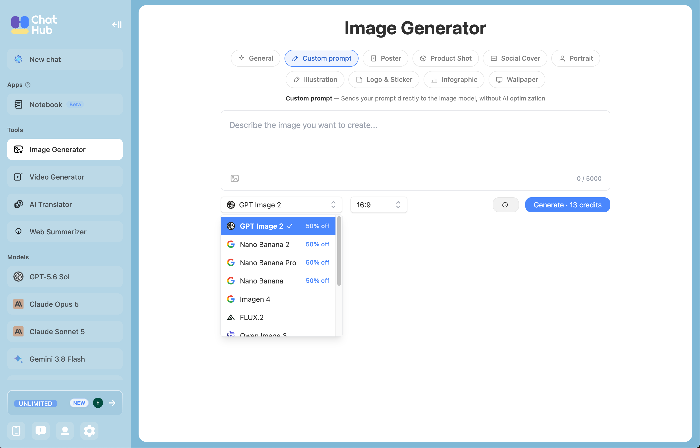
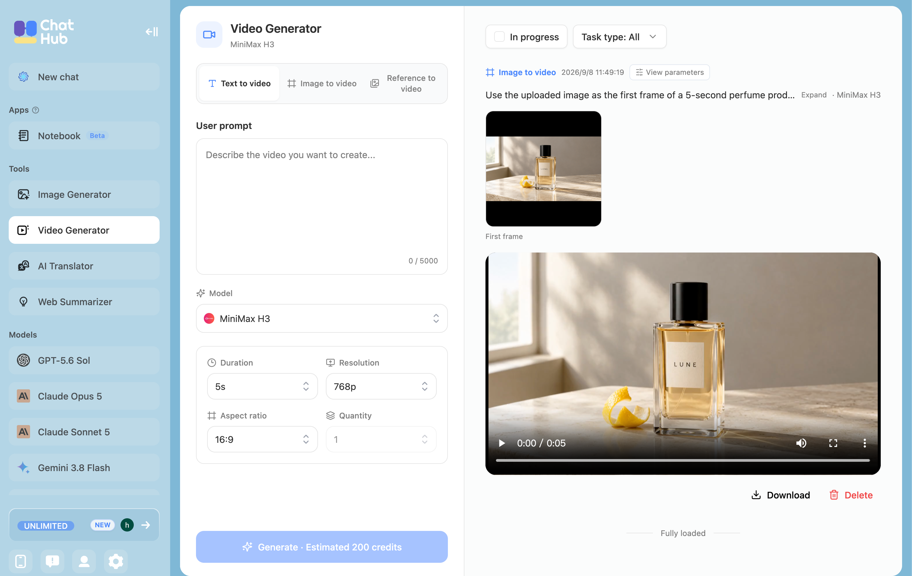

Create images and videos in ChatHub using a shared credit balance.

## Generate Images

Use the [Image Generator](https://app.chathub.gg/image-generator) to create images from text or reference images with models such as GPT Image 2, Nano Banana, and Seedream.

You can also ask supported models to generate images directly in chat.

## Generate Videos

Use the [Video Generator](https://app.chathub.gg/video-generator) to create videos with **MiniMax H3, Seedance 2.5, and Seedance 2.0**:

- Describe a scene with a text prompt.
- Upload a starting image, with an optional ending frame.
- Add reference images to guide subjects and style.

Videos can be **4–15 seconds** long. Available settings vary by model.

New to video generation? Read our [Video Generation Quick Start](/video-generation/quick-start) or browse real outputs in [Examples & Showcase](/video-generation/examples).

## Credits & Pricing

The Image Generator and Video Generator share your credit balance. **Pro includes 3,000 credits/month**, and **Unlimited includes 10,000 credits/month**. AI chat pricing and usage allowances remain unchanged. Image costs vary by model:

| Image model | Credits per image |
| --- | --: |
| Fast SDXL | 2 |
| Z Image | 4 |
| FLUX.2 | 10 |
| GPT Image 2 | 13 |
| Nano Banana | 14 |
| Nano Banana 2 | 24 |
| Seedream 4.5 | 27 |
| Nano Banana Pro | 48 |

_Prices include current discounts._ Video costs depend on the model and settings. **Check the Generate button for the estimated credit cost before submitting.** Credit costs may change as limited-time offers end or model providers adjust their prices. Current rates and discounts are shown in the generator.

Need more? You can purchase **2,500 credits for \$5**, or more at the same rate. Purchased credits are used when your plan allowance is insufficient and are valid for **3 months** — see [Purchased Credits](/cloud/purchased-credits) for details.
