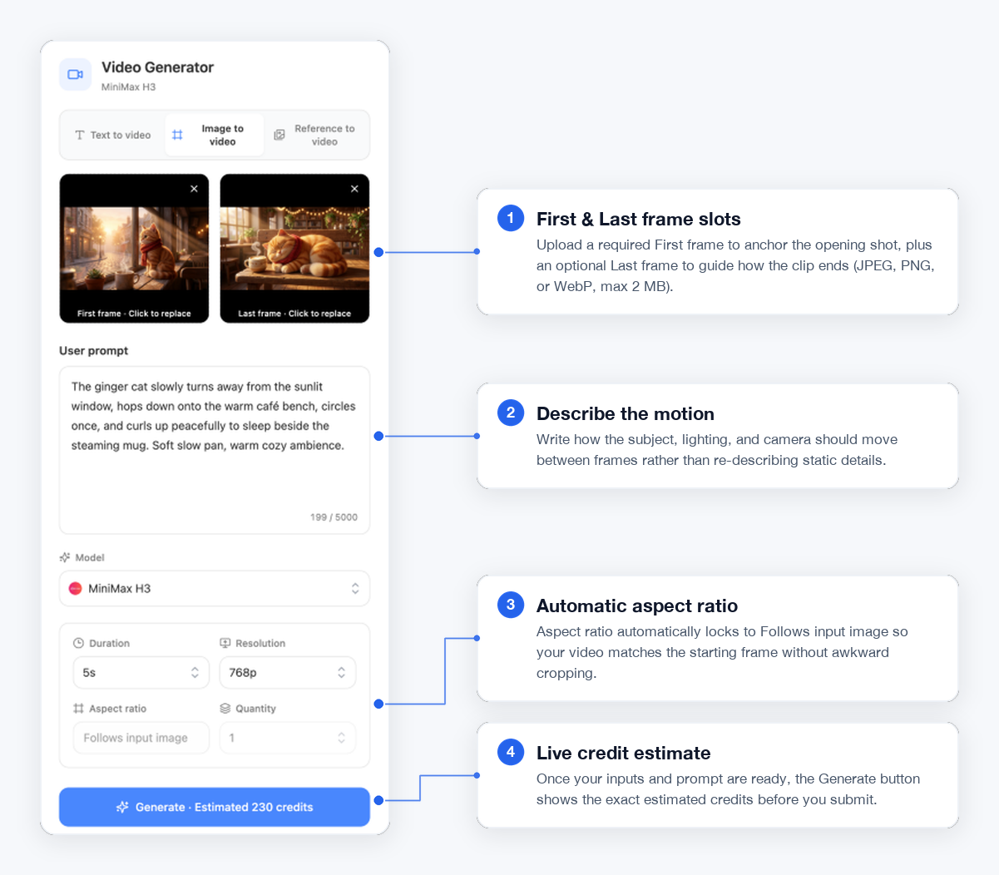
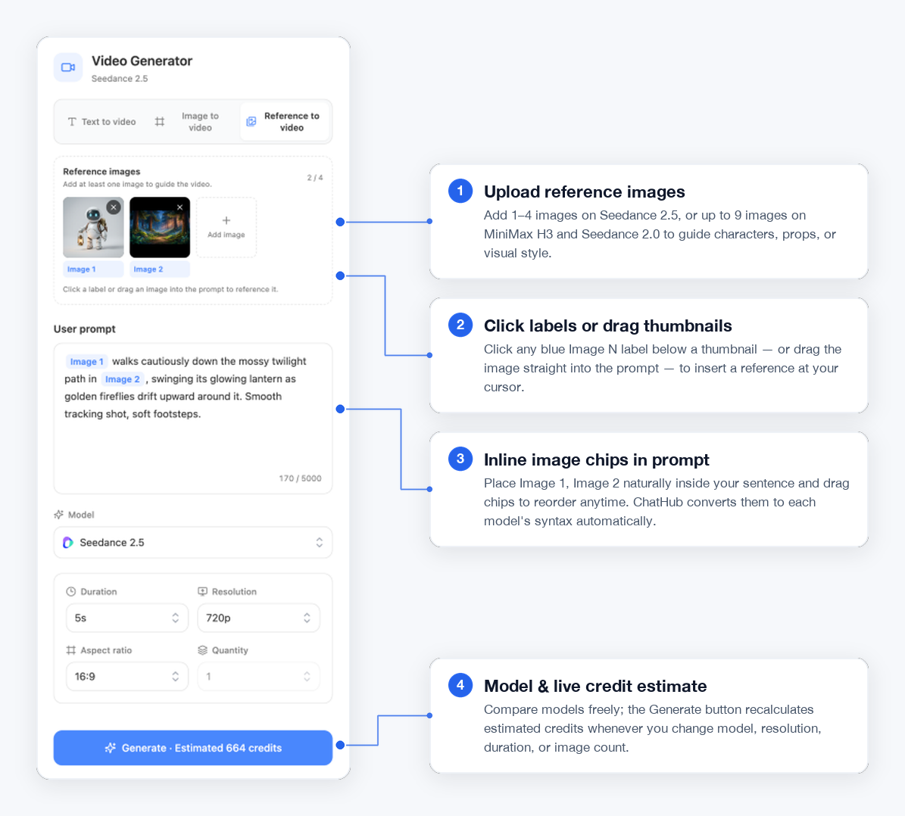
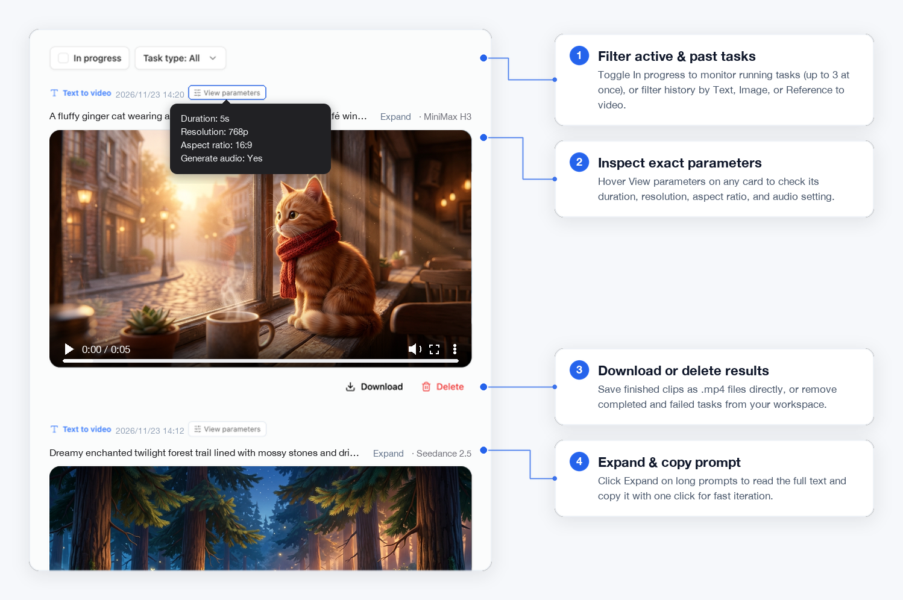

ChatHub's [Video Generator](https://app.chathub.gg/video-generator) lets you turn text prompts, starting/ending frames, and reference images into short AI videos with synchronized audio — directly in your browser.

All signed-in users (including Free accounts) can use the Video Generator as long as they have sufficient credits.

## Quick Start

<Steps>
  <Step title="Open Video Generator">
    Go to [app.chathub.gg/video-generator](https://app.chathub.gg/video-generator), or open **Tools → Video Generator** from the left sidebar (also available via the command menu). Sign in if prompted.
  </Step>
  <Step title="Choose a mode, model, and settings">
    Select one of the three modes (**Text to video**, **Image to video**, or **Reference to video**), pick a model (**MiniMax H3**, **Seedance 2.5**, or **Seedance 2.0**), and configure **Duration**, **Resolution**, and **Aspect ratio**.
  </Step>
  <Step title="Write your prompt and check the credit estimate">
    Describe the motion, scene, and mood in **User prompt** (up to 5,000 characters). Once your inputs are valid, the **Generate** button automatically calculates and displays the estimated credits (`Generate · Estimated X credits`).
  </Step>
  <Step title="Generate in the background">
    Click **Generate** (or press `Ctrl + Enter` / `Cmd + Enter`). Your task enters the queue on the right workspace. You can safely switch tabs or close the page — generation continues on our servers, and your progress restores automatically when you return.
  </Step>
</Steps>

<Frame caption="ChatHub Video Generator workspace: generation controls on the left and task history on the right.">
  
</Frame>

## Generation Modes

### Text to video

Best for creating a scene completely from scratch.

1. Switch to **Text to video**.
2. Describe the subject, action, camera movement, and atmosphere in **User prompt**.
3. Pick your **Model**, **Duration** (4–15s), **Resolution**, and **Aspect ratio** (`16:9`, `9:16`, `1:1`, `4:3`, `3:4`, or `21:9`).
4. Review the estimated credits on the **Generate** button and submit.

### Image to video

Best for animating an existing image or creating a smooth transition between two keyframes.

1. Switch to **Image to video**.
2. Upload a **First frame** (**Required**) by clicking or dragging an image into the slot.
3. Optionally upload a **Last frame** (**Optional**) if you want the video to end on a specific composition.
4. Enter a prompt describing how the scene should move between frames.

<Frame caption="Image to video mode with First frame and optional Last frame. Aspect ratio automatically follows your input image.">
  
</Frame>

<Note>
  In **Image to video** mode, **Aspect ratio** automatically switches to **Follows input image** so the generated video matches your starting frame without awkward cropping.
</Note>

### Reference to video

Best for keeping a consistent character, product, outfit, or visual style across a brand-new scene.

1. Switch to **Reference to video**.
2. Click **Add image** (or drag and drop files) to upload reference images — up to **4 images** on Seedance 2.5, or up to **9 images** on MiniMax H3 and Seedance 2.0.
3. Reference each uploaded image directly inside your prompt:
   - Newly added images are automatically inserted as blue chips (`Image 1`, `Image 2`, …).
   - Click any blue **Image N** button beneath a thumbnail, or **drag a thumbnail directly into the prompt**, to insert a reference chip at your cursor.
   - You can also drag chips inside the prompt box to reposition them. ChatHub automatically translates these chips into each model's required syntax behind the scenes.

<Frame caption="Reference to video mode: upload reference images and click or drag Image labels directly into your prompt.">
  
</Frame>

## Choosing a Model & Settings

All video models in ChatHub generate **1 video per request**, support **4–15 seconds**, and include **synchronized AI audio** automatically.

| Model | Resolutions | Duration | Reference images | Best for |
| --- | --- | --- | --- | --- |
| **MiniMax H3** _(default)_ | `768p`, `2k` | 4–15s | Up to 9 | High-res `2k` output, multi-reference scenes (5–9 images) |
| **Seedance 2.5** | `480p`, `720p`, `1080p` | 4–15s | Up to 4 | Cinematic motion, strong prompt adherence, flexible `480p` drafting |
| **Seedance 2.0** | `480p`, `720p`, `1080p` | 4–15s | Up to 9 | Lower credit cost per second, multi-reference composition (up to 9 images) |

<Tip>
  **Save credits while iterating:** Start with a **5-second** clip at a lower resolution (`480p`, `720p`, or `768p`) to test framing and motion. Once you like the result, switch to `1080p` or `2k` and increase the duration for your final render.
</Tip>

### Choosing an aspect ratio

- **`16:9`** — YouTube, presentations, desktop widescreen
- **`9:16`** — Shorts, Reels, TikTok, mobile vertical video
- **`1:1`** — Square social posts and avatars
- **`4:3` / `3:4`** — Classic landscape or vertical portrait framing
- **`21:9`** — Ultra-wide cinematic shots

## Writing Better Video Prompts

A reliable beginner formula is:

> **Subject + Action + Setting & Lighting + Camera Movement + Audio / Atmosphere**

Keep descriptions concrete and focus on **what visibly moves and changes** over the few seconds of the clip.

- **Text to video example:**
  > _A steaming ceramic pour-over coffee dripper on a sunlit oak counter, golden morning steam curling upward in slow motion, gentle dolly-in camera movement, warm café ambience with soft pouring water sounds._
- **Image to video example** _(with a cat on a windowsill as First frame and curled up asleep as Last frame)_:
  > _The ginger cat slowly turns away from the sunlit window, hops down onto the warm café bench, circles once, and curls up peacefully to sleep beside the steaming mug. Soft slow pan, warm cozy acoustic ambience._
- **Reference to video example** _(with a small robot as `Image 1` and a glowing forest path as `Image 2`)_:
  > _`Image 1` walks cautiously down the mossy twilight path in `Image 2`, swinging its glowing lantern as golden fireflies drift upward around it. Smooth tracking shot from behind, soft footsteps and gentle evening crickets._

## Credits, Queue & History Management

### How credits work

- **Shared balance:** Video generation uses the same credit balance as [Image Generation](/cloud/image-generation). Your monthly plan allowance (Pro: **3,000 credits/month**, Unlimited: **10,000 credits/month**) is always used first; if it runs out, [Purchased Credits](/cloud/purchased-credits) (`\$5` for 2,500 credits, valid for 3 months) are used automatically.
- **Live estimate before submission:** Credit cost depends on model, resolution, duration, aspect ratio, and reference image count. Check the exact estimate displayed on the **Generate** button before submitting.
- **Pre-charge & automatic refund:** Credits are reserved when your task is queued. For Seedance models, the final amount settles against actual model token usage when the video finishes. **If a generation fails, reserved credits are automatically refunded** (within the same billing period).

### Queue & workspace controls

- **Concurrency:** You can run up to **3 active tasks** (in queue or generating) simultaneously.
- **Background progress & alerts:** Active cards display live status (**In queue** / **Generating video**), elapsed time, and an estimated wait range. Allow browser notifications when prompted to get alerted the moment your video is ready.
- **Filtering & actions:** Use the top bar in the history workspace to filter by **In progress** or **Task type**. On any task card, hover **View parameters** to inspect exact settings, expand and **Copy prompt**, **Download** the `.mp4` file, or **Delete** items you no longer need.

<Frame caption="History workspace filters, generation cards, parameter inspection, and download/delete actions.">
  
</Frame>

## Troubleshooting & FAQ

<AccordionGroup>
  <Accordion title="What image formats and file sizes are supported?">
    Upload **JPEG**, **PNG**, or **WebP** images up to **2 MB per file**. Files renamed with a mismatched extension or exceeding 2 MB will be rejected.
  </Accordion>

  <Accordion title="Why was my generation rejected with a real-person privacy error?">
    Some video providers (including Seedance) restrict uploading photos that appear to contain real people for privacy protection. Try using illustrated, stylized, or non-human imagery instead.
  </Accordion>

  <Accordion title="Why did my task fail for sensitive content or copyright reasons?">
    Video providers run safety and copyright checks on prompts, input images, generated visuals, and generated audio. Remove sensitive wording, copyrighted characters/brands, or recognizable music lyrics and try again. Any reserved credits for failed tasks are automatically refunded within your current billing period.
  </Accordion>

  <Accordion title="If I close the browser tab while a video is generating, will it cancel?">
    No. Video generation runs asynchronously on ChatHub's servers. You can switch pages or close the tab at any time and come back later to watch and download the finished video.
  </Accordion>

  <Accordion title="Can I disable audio or generate multiple videos in one click?">
    Currently, each request generates **1 video** with **synchronized audio enabled automatically**. To explore multiple variations at once, you can submit up to **3 tasks concurrently**.
  </Accordion>
</AccordionGroup>
