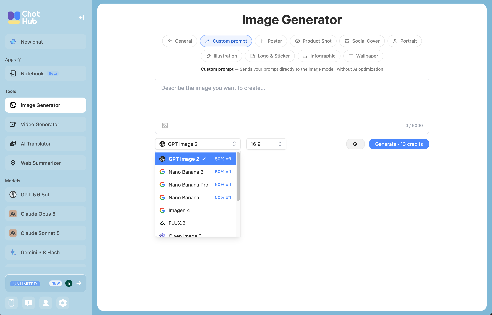

使用[图像生成器](https://app.chathub.gg/image-generator)，通过 GPT Image 2、Nano Banana 和 Seedream 等模型，根据文字或参考图像生成图像。

你也可以在对话中直接让支持图像生成的模型生成图像。

## 积分与价格

图像生成和[视频生成](/cn/video-generation/quick-start)共用同一个积分余额。**Pro 每月包含 3,000 积分**，**Unlimited 每月包含 10,000 积分**。AI 对话的价格和用量额度保持不变。

生成图像所需的积分因模型而异：

| 图像模型 | 每张图像所需积分 |
| --- | --: |
| Fast SDXL | 2 |
| Z Image | 4 |
| FLUX.2 | 10 |
| GPT Image 2 | 13 |
| Nano Banana | 14 |
| Nano Banana 2 | 24 |
| Seedream 4.5 | 27 |
| Nano Banana Pro | 48 |

_以上价格已包含当前优惠。_ 限时优惠结束或模型提供商调整价格时，所需积分可能发生变化。当前价格和优惠会显示在生成器中。

需要更多积分？你可以花 **5 美元购买 2,500 积分**，也可以按相同比例购买更多积分。订阅计划的积分额度不足时，会使用购买的积分；购买的积分有效期为 **3 个月**，详见[购买积分](/cn/cloud/purchased-credits)。
