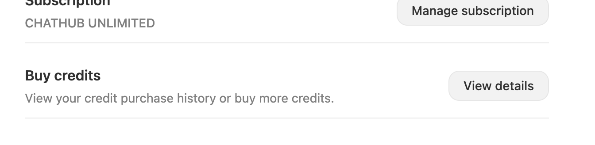
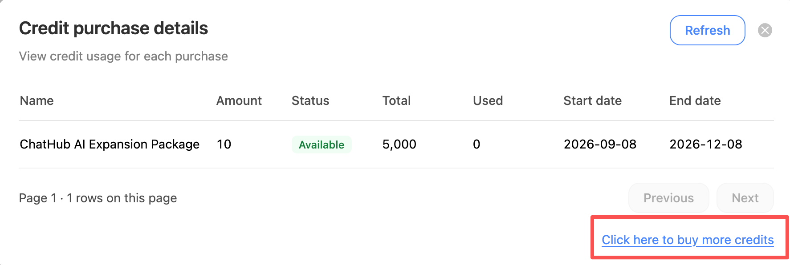
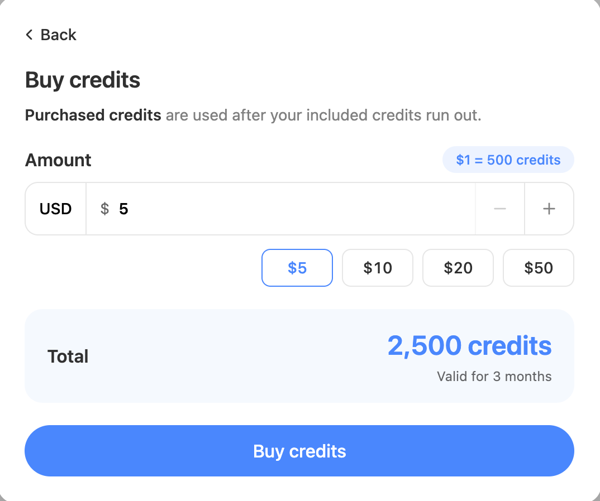
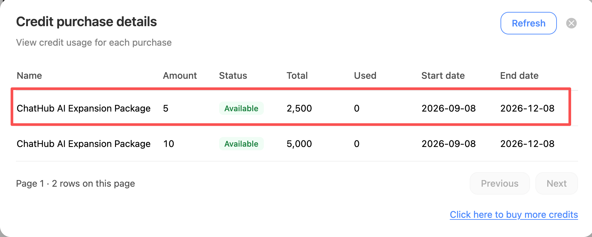

当你的会员月度包含积分不足时，可以通过购买额外积分继续生成图像和视频。

- 兑换比例为 **\$1 = 500 积分**，最低 **\$5 起购（2,500 积分）**。
- 购买的积分自购买之日起 **3 个月内有效**。
- 系统会优先消耗每月会员额度，不足时再自动扣除已购买的积分。

## 购买与查看步骤

<Steps>
  <Step title="打开积分明细">
    在个人账号页面找到**购买积分（Buy credits）区域，点击查看详情（View details）**。

    
  </Step>
  <Step title="查看已购记录">
    在\*\*积分购买详情（Credit purchase details）\*\*弹窗中，可以查看每笔订单的状态、总积分、已用积分和过期时间。如需继续充值，点击底部的 **Click here to buy more credits**。

    
  </Step>
  <Step title="选择金额并完成支付">
    选择预设金额或自定义金额，核对总积分数与有效期后，点击 **Buy credits** 前往支付。

    
  </Step>
  <Step title="刷新查看新到账积分">
    支付完成后返回**积分购买详情**即可看到新增记录；如尚未显示，请点击**刷新（Refresh）**。

    
  </Step>
</Steps>
