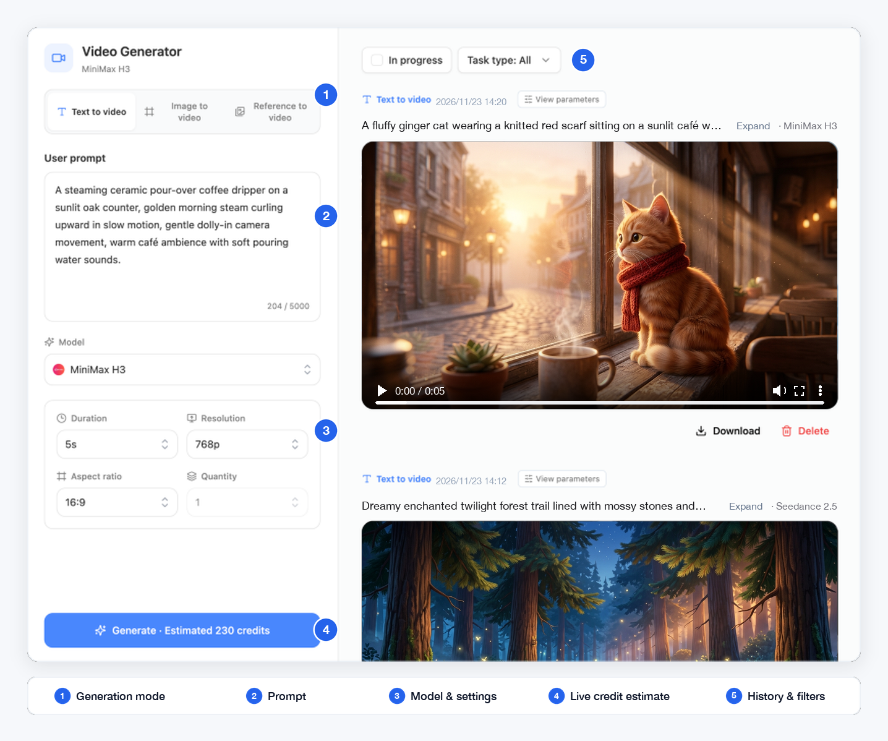
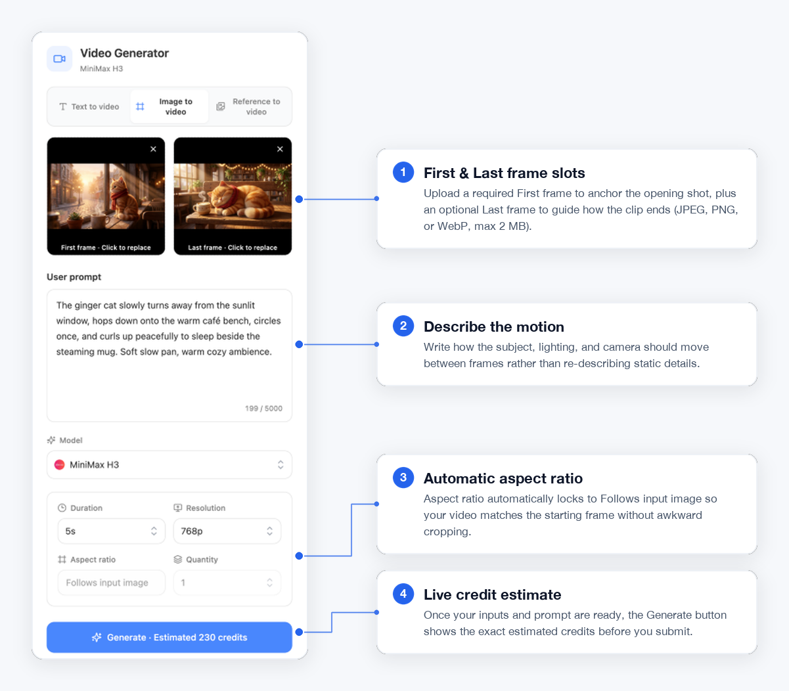
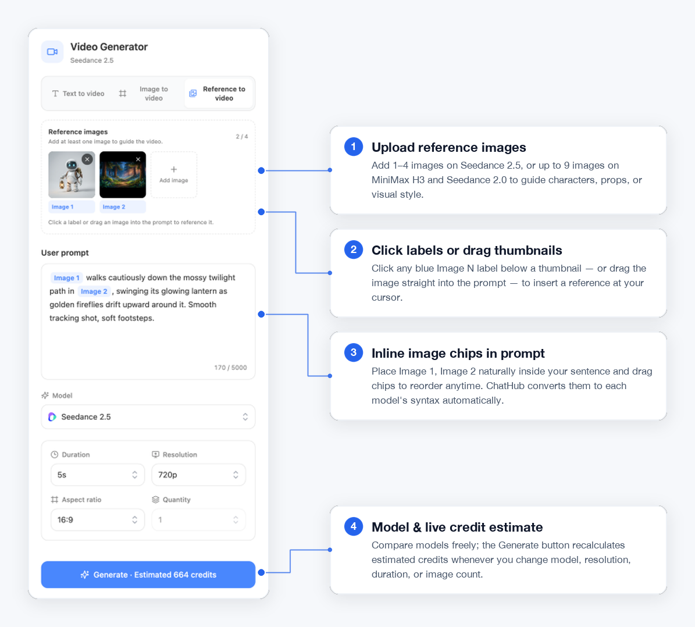
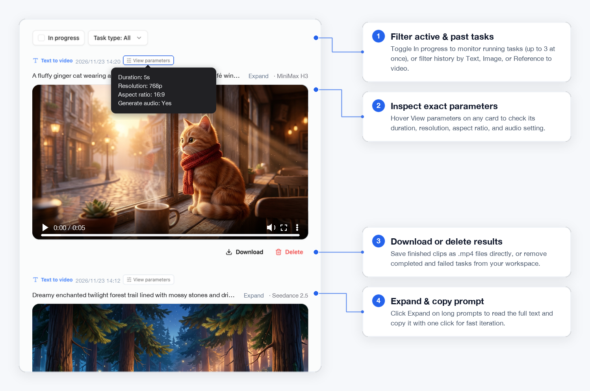
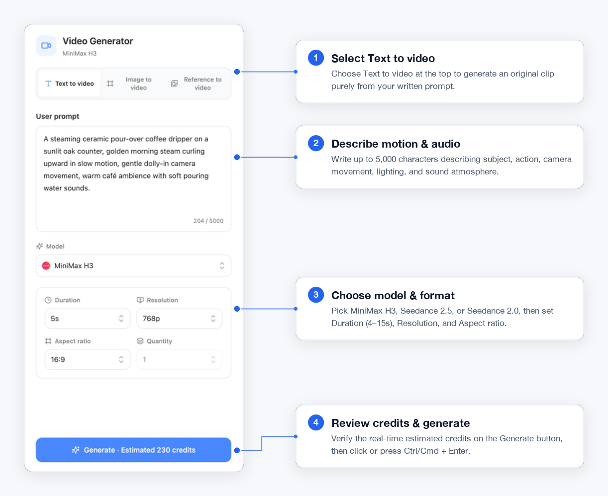

通过 ChatHub 的[视频生成器](https://app.chathub.gg/video-generator)，你可以直接在浏览器中用文字、首尾帧图片或多张参考图创作带有同步音频的 AI 视频。

所有已登录用户（包括免费账号）只要拥有足够点数，均可使用视频生成功能。

## 快速开始

<Steps>
  <Step title="打开视频生成器">
    访问 [app.chathub.gg/video-generator](https://app.chathub.gg/video-generator)，或在左侧边栏点击 **Tools → Video Generator**（中文界面为「工具 → 视频生成器」，也可通过命令菜单打开）。如尚未登录，请先登录账号。
  </Step>
  <Step title="选择模式、模型与参数">
    在左侧面板选择一种生成模式（**文生视频**、**图生视频**或**参考生视频**），挑选模型（**MiniMax H3**、**Seedance 2.5** 或 **Seedance 2.0**），并设置**时长**、**分辨率**与**画幅比例**。
  </Step>
  <Step title="输入提示词并确认预计点数">
    在提示词输入框中描述你想看到的画面动作与氛围（最多 5,000 字符）。参数与素材就绪后，底部的**生成**按钮会自动显示本次任务的预计消耗点数（`生成 · 预计 X 点`）。
  </Step>
  <Step title="提交并在后台等待出片">
    点击**生成**（或使用快捷键 `Ctrl + Enter` / `Cmd + Enter`），任务会进入右侧工作区排队生成。**你可以放心切换页面或关闭标签页**，任务会在服务端继续运行，返回页面时会自动同步进度。
  </Step>
</Steps>

<Frame caption="ChatHub 视频生成器界面：左侧配置模式、提示词与参数，右侧查看排队进度与历史视频。">
  
</Frame>

## 三种生成模式

### 文生视频（Text to video）

适合完全用文字从零构思画面。

1. 切换到 **文生视频（Text to video）**。
2. 在提示词框里描述主体、动作、镜头运动与光线氛围。
3. 选择 **模型**、**时长**（4–15 秒）、**分辨率**与**画幅比例**（`16:9`、`9:16`、`1:1`、`4:3`、`3:4`、`21:9`）。
4. 确认生成按钮上的预计点数后点击生成。

### 图生视频（Image to video）

适合让一张静图动起来，或指定开头和结尾画面做平滑过渡。

1. 切换到 **图生视频（Image to video）**。
2. 点击或拖入图片上传**首帧（必填）**。
3. 如需控制视频的结束画面，可继续上传**尾帧（可选）**。
4. 在提示词中描述从首帧开始的动态变化（以及向尾帧过渡的过程）。

<Frame caption="图生视频模式：上传首帧与可选尾帧，画幅比例会自动跟随输入图片。">
  
</Frame>

<Note>
  在**图生视频**模式下，画幅比例会自动切换为**跟随输入图片（Follows input image）**，以确保输出画面与首帧比例一致、不被生硬裁切。
</Note>

### 参考生视频（Reference to video）

适合在新场景中保持角色形象、物品外观或整体画风的一致性。

1. 切换到 **参考生视频（Reference to video）**。
2. 点击 **Add image（添加图片）** 或直接拖入多张参考图：Seedance 2.5 最多支持 **4 张**，MiniMax H3 与 Seedance 2.0 最多支持 **9 张**。
3. 在提示词里直接指代这些参考图：
   - 上传参考图后，提示词框会自动追加对应的蓝色图片标签（`图片 1`、`图片 2`…）。
   - 你可以随时**点击缩略图下方的蓝色标签**，或**直接把参考图拖进提示词的光标位置**来插入指代芯片。
   - 已插入的标签也可以在提示词内自由拖拽调整顺序，ChatHub 会在提交时自动转换成所选模型对应的标准引用语法。

<Frame caption="参考生视频模式：上传多张参考图后，点击标签或直接拖拽图片到提示词中指代对应元素。">
  
</Frame>

## 模型与参数怎么选

ChatHub 中的所有视频模型目前均支持 **4–15 秒**时长、单次生成 **1 条视频**，并**默认自动生成同步音频**。

| 模型 | 支持分辨率 | 时长 | 参考图上限 | 适用场景 |
| --- | --- | --- | --- | --- |
| **MiniMax H3**（默认） | `768p`、`2k` | 4–15 秒 | 最多 9 张 | 需要 `2k` 高清画质，或同时使用 5–9 张参考图 |
| **Seedance 2.5** | `480p`、`720p`、`1080p` | 4–15 秒 | 最多 4 张 | 镜头运动流畅、提示词遵循度高，适合先用 `480p` 试稿 |
| **Seedance 2.0** | `480p`、`720p`、`1080p` | 4–15 秒 | 最多 9 张 | 性价比更高，且支持最多 9 张参考图组合 |

<Tip>
  **新手省点数技巧**：构思初期建议先用 **5 秒** + 较低分辨率（`480p` / `720p` / `768p`）验证构图与动态效果；确认满意后再切换 `1080p` 或 `2k` 并拉长时长出成片。
</Tip>

### 常用画幅参考

- **`16:9`**：横屏视频、B 站 / YouTube、演示素材
- **`9:16`**：短视频、抖音 / 小红书 / Reels 竖屏
- **`1:1`**：方形社媒配图与动态封面
- **`4:3` / `3:4`**：经典横版或竖版构图
- **`21:9`**：电影宽银幕氛围

## 新手提示词公式与示例

一个好上手的通用写法是：

> **主体 + 动作变化 + 场景与光影 + 镜头运动 + 声音/氛围**

尽量具体描述**这几秒内画面里发生了什么变化**，而不是堆砌静态形容词。

- **文生视频示例**：
  > 阳光洒落的橡木吧台上，一只手冲咖啡壶正缓缓注水，温热的白雾在清晨金光中慢动作升腾。镜头缓慢推进，伴随轻柔的水流声与温暖的咖啡馆环境音。
- **图生视频示例**（首帧为窗台上的橘猫，尾帧为趴在长椅上睡着的橘猫）：
  > 围着红围巾的橘猫从洒满晨光的窗台缓缓转头，轻巧地跳到旁边的木质长椅上，原地转了一圈后蜷缩在热拿铁旁安静入睡。镜头柔和横移，氛围温暖治愈。
- **参考生视频示例**（`图片 1` 为白色小机器人，`图片 2` 为萤火虫森林小径）：
  > `图片 1` 提着微微发光的提灯，沿着 `图片 2` 中长满青苔的暮色林间小路慢慢前行，金色萤火虫在它周围缓缓飘起。镜头从背后平稳跟拍，伴随轻柔的脚步声和夏夜虫鸣。

## 点数计费、后台排队与历史管理

### 点数规则

- **与图像生成共享额度**：视频生成和[图像生成](/cn/cloud/image-generation)共用同一套点数余额。系统优先消耗每月会员额度（Pro 会员 **3,000 点/月**，Unlimited 会员 **10,000 点/月**），不足时自动扣除充值点数（`\$5` 起购 2,500 点，有效期 3 个月）。
- **提交前实时估算**：点数消耗取决于模型、分辨率、时长、画幅比例以及参考图数量，提交前可在**生成**按钮上直接看到预计点数。
- **预扣与失败自动退款**：任务提交排队时会先预扣点数；Seedance 系列在生成完成后会按实际用量多退少补。**如果任务最终生成失败，预扣点数会自动退还**（同一计费周期内）。

### 队列与历史区操作

- **并发限制**：同一时间最多可运行 **3 个**进行中（排队中或生成中）的视频任务。
- **后台运行与通知**：进行中的卡片会显示当前状态（排队中 / 正在生成视频）、已耗时与预计等待时间；允许浏览器通知后，视频出片时会第一时间提醒你。
- **筛选与管理**：右侧顶部支持按**进行中**和**任务类型**筛选；每条任务均支持悬浮**查看参数**、展开并**复制提示词**、**下载** `.mp4` 视频或**删除**记录。

<Frame caption="右侧工作区支持按状态与类型筛选，并提供查看参数、复制提示词、下载与删除操作。">
  
</Frame>

## 常见问题（FAQ）

<AccordionGroup>
  <Accordion title="上传首尾帧或参考图有哪些格式与大小限制？">
    目前支持 **JPEG**、**PNG** 和 **WebP** 格式，单张图片大小不得超过 **2 MB**。请避免仅修改文件后缀名导致格式校验失败。
  </Accordion>

  <Accordion title="为什么提示图片包含真人而被拒绝？">
    部分视频模型供应商（如 Seedance）出于隐私保护策略，会拦截包含真人人脸或真人照片的输入图片。建议改用插画、3D 角色或其他非真人素材重试。
  </Accordion>

  <Accordion title="生成失败提示敏感内容或版权限制怎么办？">
    视频供应商会对提示词、输入图片以及生成的画面和音频进行安全与版权审核。请修改可能触发审核的措辞，或避免出现受版权保护的品牌、影视角色与配乐。生成失败的任务会在当前计费周期内自动退还预扣点数。
  </Accordion>

  <Accordion title="生成过程中关闭网页或切到别的页面会中断吗？">
    不会。视频生成在服务端异步执行，你可以随时离开或关闭页面，稍后重新打开视频生成器即可查看和下载成品。
  </Accordion>

  <Accordion title="可以关闭音频，或者一次生成多条视频吗？">
    目前每次提交固定生成 **1 条**视频，并默认附带同步音频。如果想同时测试多个创意版本，可以连续提交，最多支持 **3 个任务同时进行**。
  </Accordion>
</AccordionGroup>
