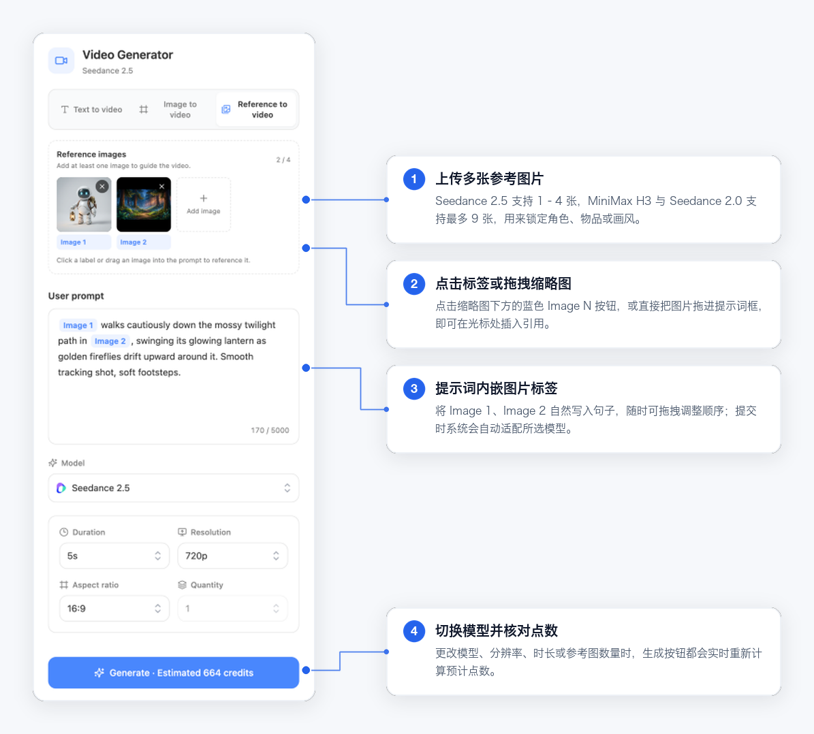
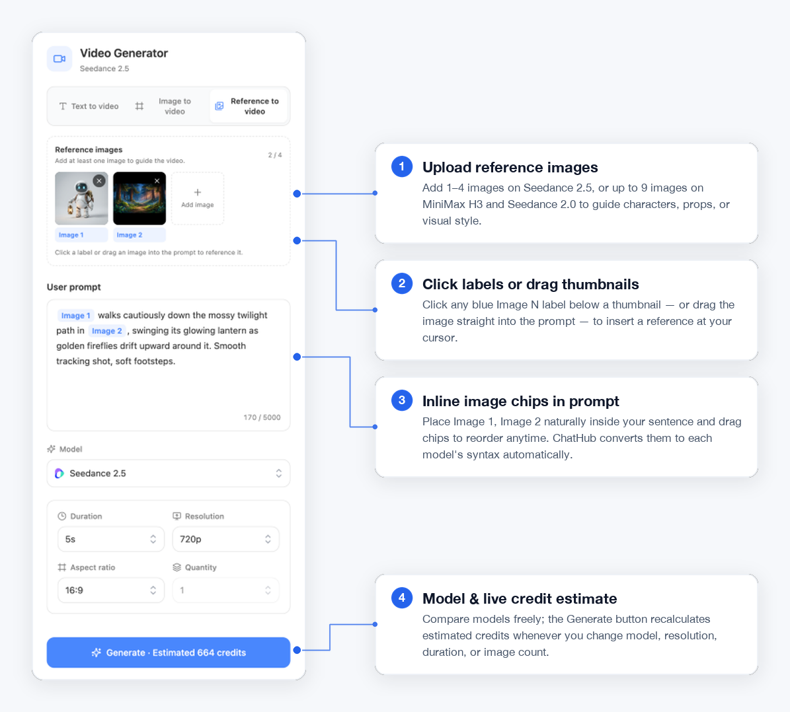

## 点数计费规则

- **与图像生成共享余额**：视频生成与[图像生成](/cn/cloud/image-generation)共用同一套点数余额。系统优先消耗每月会员额度（Pro 会员 **3,000 点/月**，Unlimited 会员 **10,000 点/月**；免费账号也有基础体验额度）。
- **额度不足自动用充值点数**：当月度额度不足时，系统会自动使用充值点数（`\$5` 起购 2,500 点，自购买起 3 个月有效）。
- **提交前实时显示预计点数**：点数消耗取决于模型、分辨率、时长、画幅比例以及参考图数量，参数就绪后即可在**生成**按钮上看到预计点数（`生成 · 预计 X 点`）。
- **预扣与结算**：任务提交排队时会先预扣点数；Seedance 系列在出片后会按模型实际用量结算。
- **生成失败自动退款**：如果任务最终生成失败，**预扣点数会自动退还**（同一计费周期内）。

## 常见问题与故障排查（FAQ）

<AccordionGroup>
  <Accordion title="上传首尾帧或参考图有哪些格式与大小限制？">
    仅支持 **JPEG**、**PNG** 和 **WebP** 格式，单张图片大小上限为 **2 MB**。超过 2 MB 或仅改了后缀名但实际格式不符的图片会被拒绝。
  </Accordion>

  <Accordion title="为什么提示图片包含真人而被拒绝？">
    部分视频模型供应商（如 Seedance）出于隐私保护策略，会拦截疑似包含真人人脸或照片的输入图片。建议改用插画、3D 角色或其他非真人素材重试。
  </Accordion>

  <Accordion title="生成失败并提示敏感内容或版权限制怎么办？">
    视频供应商会对提示词、上传图片以及生成的画面和音频进行安全与版权审核。请修改可能触发审核的措辞，或移除受版权保护的品牌、影视角色与配乐后重试。失败任务的预扣点数会在当前计费周期内自动退还。
  </Accordion>

  <Accordion title="生成过程中关闭标签页或切换页面会中断吗？">
    不会。视频生成在 ChatHub 服务端异步运行，你可以随时切换页面或关闭浏览器，之后回到[视频生成器](https://app.chathub.gg/video-generator)即可查看进度和下载成片。
  </Accordion>

  <Accordion title="最多可以同时生成几条视频？">
    每个账号最多可同时运行 **3 个**进行中（排队中或生成中）的视频任务；任意任务完成或失败后，名额会立刻释放。
  </Accordion>

  <Accordion title="可以关闭音频，或者一次生成多个版本吗？">
    目前每次提交固定生成 **1 条**视频，并默认自动附带同步音频。如果想并行尝试多个版本，可以连续提交，最多支持 3 个任务同时生成。
  </Accordion>
</AccordionGroup>
