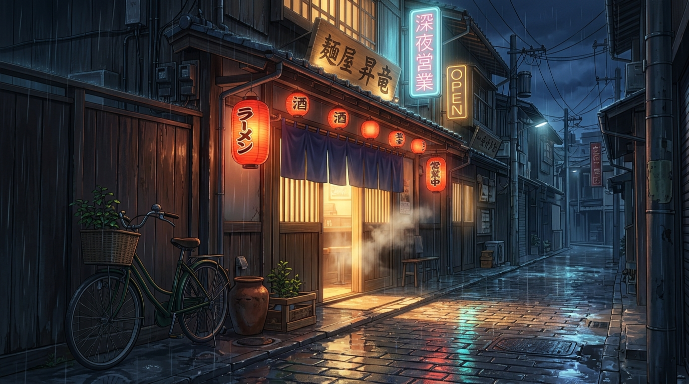
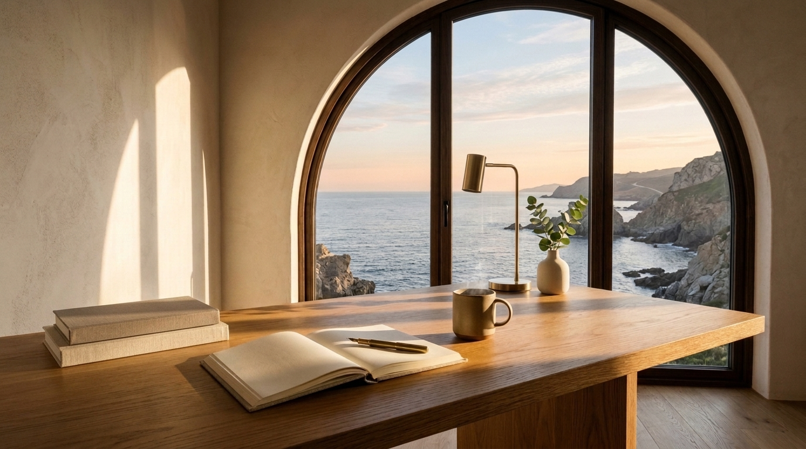
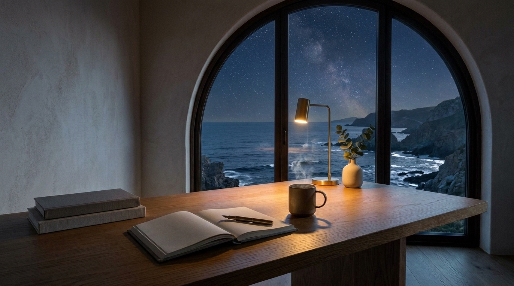
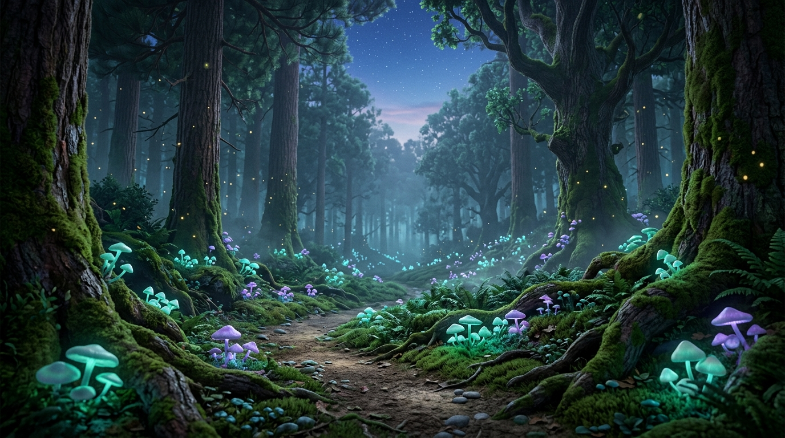

本页展示的 4 条视频均直接在 [ChatHub 视频生成器](https://app.chathub.gg/video-generator)中生成，全部包含原生同步音频。播放视频时建议开启声音，体验 AI 自动生成的拟真音效与环境音。

## 案例速览

| # | 案例主题 | 生成模式 | 推荐模型 | 成片参数 | 试稿 → 成片预估点数\* |
| :-: | --- | --- | --- | --- | --- |
| **1** | **瑞士阿尔卑斯红皮列车晨雾航拍** | 文生视频 | `Seedance 2.5` | `9:16` · `8s` · `1080p` | `296` → `2,729` |
| **2** | **雨夜霓虹拉面街角插画动效** | 图生视频（仅首帧） | `MiniMax H3` | 跟随原图 · `6s` · `2k` | `276` → `449` |
| **3** | **同一机位昼夜光影无缝延时** | 图生视频（首帧 + 尾帧） | `MiniMax H3` | 跟随原图 · `10s` · `2k` | `460` → `748` |
| **4** | **多素材固定角色奇幻短片** | 参考生视频（3 张图） | `Seedance 2.0` | `16:9` · `8s` · `1080p` | `202` → `1,796` |

<Note>
  \*实际消耗点数会随模型定价、分辨率、时长、画幅比例和参考图数量动态变化，提交前请以底部**生成**按钮上的实时预估为准。
</Note>

---

## 案例 1：瑞士阿尔卑斯红皮列车晨雾航拍（文生视频）

无需任何图片素材，纯文字即可生成纪录片级实拍质感的竖屏无人机航拍——红色山地列车平稳驶过峡谷石拱高架桥，晨雾在松林间缓缓流动，镜头拉升展现雪山纵深，并自带真实铁轨声与山谷风声。

<Frame caption="实测成片：Seedance 2.5 · 文生视频 · 9:16 · 8s · 1080p（含列车铁轨声、山谷风声与远方冰川河水声）。">
  <div className="mx-auto max-w-[320px]">
  <video controls playsInline preload="metadata" poster="/images/video-generation/examples/case1-alpine-poster.jpg" className="w-full rounded-xl">
    <source src="/videos/video-generation/case1-alpine-train.mp4" type="video/mp4" />
  </video>
</div>
</Frame>

### 可直接复制的提示词

```text
瑞士阿尔卑斯山日出时分的真实纪录片无人机航拍电影画面。一列经典的鲜红色山地铁路列车平稳匀速地驶过一座高耸风化的灰色石拱高架桥，桥下是云雾缭绕的深邃高山峡谷。半透明的金色晨雾缓缓漂浮在陡峭岩壁与覆雪冷杉松林之间，清透的清晨日光照亮远处淡蓝天空下巍峨起伏的积雪山峰。真实自然的电影调色、细腻的大气薄雾层次、写实光影与阴影，零 CG 塑料感。无人机镜头平稳向后拉远并缓缓攀升，层层展现石拱高架桥与整片高山峡谷的壮阔纵向尺度。同步自然户外音效：列车车轮驶过钢轨的真实规律碰撞声、山谷间轻柔回荡的晨风声，以及峡谷深处若隐若现的冰川河水流声。
```

<Accordion title="查看本案例成片实际提交所用的英文提示词">
  ```text
  Authentic documentary aerial cinema footage captured on a real cinema drone at sunrise in the Swiss Alps. A classic bright-red mountain railway train glides smoothly and steadily across a towering weathered gray stone arch viaduct spanning a deep misty alpine gorge. Wisps of translucent golden morning fog drift slowly through dark snow-dusted pine trees along the steep rocky canyon walls, while crisp early sunrise light illuminates rugged snow-covered mountain peaks rising high into a pale blue sky in the background. Natural real-world color grading, subtle atmospheric haze, realistic lighting and shadows, zero CGI sheen. The camera performs a smooth, steady aerial pull-back and gentle ascent, revealing the breathtaking vertical scale of the stone bridge and valley below. Synchronized natural outdoor audio: authentic rhythmic clatter of train wheels rolling over steel rails, soft echoing alpine wind, and the distant rush of a glacial river deep in the gorge.
  ```
</Accordion>

### 参数配置（试稿 vs 成片）

| 阶段 | 模式 | 模型 | 画幅比例 | 时长 | 分辨率 | 实测预估点数 |
| --- | --- | --- | --- | --- | --- | --- |
| **低成本试稿**（验证构图与航拍轨迹） | 文生视频 | `Seedance 2.5` | `9:16` | `5s` | `480p` | `296` |
| **正式出片**（1080p 高清交付） | 文生视频 | `Seedance 2.5` | `9:16` | `8s` | `1080p` | `2,729` |

### 效果拆解与实战技巧

- **用纪录片镜头语言消除「AI/CG 感」**：明确写出「真实纪录片无人机航拍」「真实自然调色」「细腻大气薄雾」「零 CG 质感」，生成的动态范围、石桥砌砖与松林层次会明显更接近实拍素材。
- **单一路线长运镜更稳、更有纵深感**：连续平稳的「拉远 + 缓升」航拍非常适合 `9:16` 竖屏构图，从红皮列车与石桥墩一路拉升到云雾峡谷和雪山顶峰，全程无镜头跳切。
- **先用 `480p` 试稿再升 `1080p`**：`5s + 480p` 仅需 `296` 点，不到正式 `8s + 1080p` 成片的 **1/9**；先低成本验证构图与运镜轨迹，满意后再切高清出片。

---

## 案例 2：雨夜霓虹拉面街角插画动效（图生视频 · 仅首帧）

把静态插画、海报或概念图一键变成 `2k` 超清动态画面，同时保持灯牌文字与建筑线条稳定不崩坏。

### 输入素材（首帧）

<Frame caption="上传的首帧图片（16:9 日系雨夜拉面街角插画，可右键保存原图直接体验复现）。">
  
</Frame>

### 实测成片

<Frame caption="实测成片：MiniMax H3 · 图生视频（仅首帧） · 跟随输入图片 · 6s · 2k（含舒缓雨声与街巷环境音）。">
  <video controls playsInline preload="metadata" poster="/images/video-generation/examples/case2-poster.jpg" className="w-full rounded-xl">
    <source src="/videos/video-generation/case2-ramen-alley-hd.mp4" type="video/mp4" />
  </video>
</Frame>

### 可直接复制的提示词

```text
雨夜小巷的柔和氛围动态。细密的雨丝持续斜落过发光的霓虹灯牌与红灯笼，在湿漉漉的石板积水里激起细微涟漪，斑斓倒影轻轻荡漾。温暖的白色蒸汽从深蓝暖帘下方缓缓飘出并向上卷散，屋檐下的红灯笼在微凉夜风中轻轻摇曳。镜头沿小巷极其缓慢、平稳地向温暖发光的店门推进。同步环境音效：舒缓连绵的雨滴落石板与屋檐声、轻柔夜风，以及店内隐约传出的温暖厨房声响。
```

<Accordion title="查看本案例成片实际提交所用的英文提示词">
  ```text
  Gentle atmospheric animation of the rainy night alley. Fine raindrops fall steadily across the glowing neon signs and red paper lanterns, creating subtle expanding ripples across the wet cobblestone puddles while colorful reflections shimmer. Warm white steam drifts softly upward and curls outward beneath the indigo doorway curtain as the hanging lanterns sway slightly in a cool night breeze. Very slow, steady cinematic camera push-in along the alley toward the warm glowing shopfront. Synchronized ambient audio: soothing steady rainfall on pavement and eaves, soft distant breeze, and faint cozy kitchen murmur from inside the shop.
  ```
</Accordion>

### 参数配置（试稿 vs 成片）

| 阶段 | 模式 | 模型 | 画幅比例 | 时长 | 分辨率 | 实测预估点数 |
| --- | --- | --- | --- | --- | --- | --- |
| **试稿验证** | 图生视频（仅首帧） | `MiniMax H3` | 跟随输入图片 | `6s` | `768p` | `276` |
| **2K 成片** | 图生视频（仅首帧） | `MiniMax H3` | 跟随输入图片 | `6s` | `2k` | `449` |

### 效果拆解与实战技巧

- **「动静分离」心法**：模型已经能看懂你上传的首帧图，提示词里**不要重复描述**自行车、木墙或招牌文字，只需聚焦「哪些元素在动」（雨丝、水洼涟漪、热气、灯笼轻摆）和「镜头怎么缓慢移动」。
- **保护文字与细节不畸变**：克制的缓慢推进镜头配合 `MiniMax H3` 的 `2k` 分辨率，能让画面里的日文灯牌与线条自始至终保持锐利清晰。
- **超高画质性价比**：`MiniMax H3` 渲染 `6s` 的 `2k` 超清视频仅需 `449` 点，非常适合做动态海报、B 站/YouTube 片头与氛围感循环背景。

---

## 案例 3：同一机位昼夜光影无缝延时（图生视频 · 首帧 + 尾帧）

固定机位并同时上传**首帧**与**尾帧**，精准控制视频的开场与收尾状态，以原生 `2k` 实现丝滑的一镜到底昼夜延时摄影。

### 输入素材（首帧 → 尾帧）

<div className="grid grid-cols-1 gap-4 sm:grid-cols-2">
  <Frame caption="首帧：清晨阳光洒满书桌，黄铜台灯关闭。">
    
  </Frame>

  <Frame caption="尾帧：深夜银河星空，黄铜台灯亮起温暖光晕。">
    
  </Frame>
</div>

### 实测成片

<Frame caption="实测成片：MiniMax H3 · 图生视频（首帧 + 尾帧） · 跟随输入图片 · 10s · 2k。">
  <video controls playsInline preload="metadata" poster="/images/video-generation/examples/case3-desk-poster-v2.jpg" className="w-full rounded-xl">
    <source src="/videos/video-generation/case3-desk-timelapse-v2.mp4" type="video/mp4" />
  </video>
</Frame>

### 可直接复制的提示词

```text
固定三脚架完全静止机位，记录从清晨到深夜的丝滑连续延时变化。拱形窗外，晨间薄云快速掠过天空，清透的金色晨光在抹灰墙面与橡木桌面上缓缓移动，随后在海崖上空过渡为绚丽的琥珀色日落晚霞，天色渐暗进入深蓝暮色，最终浮现璀璨银河星空与银色海面月光。随着室内暮色降临，黄铜台灯柔和亮起，将温暖的金色光晕洒在冒着热气的陶瓷咖啡杯、摊开的速写本、黄铜钢笔、尤加利花瓶与叠放的亚麻精装书上。同步环境音效：远处柔和起伏的海浪声、轻柔的海风，以及台灯亮起时的轻柔开关声。
```

<Accordion title="查看本案例成片实际提交所用的英文提示词">
  ```text
  Completely locked static tripod camera capturing a smooth, continuous day-to-night time-lapse from early morning to late night. Outside the arched window, soft morning clouds drift swiftly across the sky as crisp golden morning sunbeams arc slowly across the plaster wall and oak desk, warming into a vivid amber sunset glowing over the ocean cliffs before fading into deep blue twilight and revealing a sparkling starry Milky Way night sky with silver moonlight shimmering on the dark ocean. As evening dusk settles indoors, the brushed-brass architectural desk lamp gently switches on, casting a warm golden pool of light over the steaming ceramic coffee mug, open hardcover sketchbook, brass fountain pen, eucalyptus vase, and stacked linen books. Synchronized ambient soundscape: gentle distant ocean waves swelling and receding, soft coastal evening breeze, and a subtle warm click as the desk lamp turns on.
  ```
</Accordion>

### 参数配置（试稿 vs 成片）

| 阶段 | 模式 | 模型 | 画幅比例 | 时长 | 分辨率 | 实测预估点数 |
| --- | --- | --- | --- | --- | --- | --- |
| **试稿验证** | 图生视频（首尾帧） | `MiniMax H3` | 跟随输入图片 | `10s` | `768p` | `460` |
| **2K 正式成片** | 图生视频（首尾帧） | `MiniMax H3` | 跟随输入图片 | `10s` | `2k` | `748` |

### 效果拆解与实战技巧

- **首尾帧构图必须严格对齐**：窗框、桌沿、精装书、速写本、咖啡杯、台灯和花瓶的位置在两张图里保持完全一致，模型就能把全部运动预算用在天光流转与亮灯变化上，不会出现物体漂移变形。
- **延时画面尽量避免放时钟或可读数字**：完全依靠自然天光弧线（晨光 → 晚霞 → 蓝调暮色 → 银河星空 + 台灯亮起）就能直观传递时间流逝，避免时钟数字在压缩延时中停滞或跳变穿帮。
- **写出中间过渡并给足时长**：首尾原图里都没有日落，在提示词里补上「过渡为琥珀色日落晚霞再渐暗进入深蓝暮色」并给足 **`10 秒`**，模型就会自然补全完整的黄昏落日与亮灯过程。

---

## 案例 4：多素材固定角色奇幻短片（参考生视频 · 3 张参考图）

把**角色**、**道具**和**场景**拆成 3 张独立参考图，并在提示词中插入蓝色图片标签精准绑定，彻底解决 AI 视频容易「换脸、丢道具、跑画风」的痛点。

### 输入素材（3 张参考图）

在**参考生视频**模式下，按以下顺序依次上传 3 张图片（分别对应 `图片 1`、`图片 2`、`图片 3`）：

<div className="grid grid-cols-1 gap-4 sm:grid-cols-3">
  <Frame caption="图片 1 — 主角（黄色复古发条小机器人）">
    
  </Frame>

  <Frame caption="图片 2 — 道具（发光玻璃萤火虫提灯）">
    
  </Frame>

  <Frame caption="图片 3 — 场景（暮色荧光蘑菇古林小径）">
    
  </Frame>
</div>

### 实测成片

<Frame caption="实测成片：Seedance 2.0 · 参考生视频（3 张图） · 16:9 · 8s · 1080p。">
  <video controls playsInline preload="metadata" poster="/images/video-generation/examples/case4-poster.jpg" className="w-full rounded-xl">
    <source src="/videos/video-generation/case4-robot-forest-hd.mp4" type="video/mp4" />
  </video>
</Frame>

### 可直接复制的提示词

在视频生成器中输入时，请将下方 `[图片 N]` 替换为**点击缩略图下方蓝色 `图片 N` 标签**（或直接把参考图拖入提示词框）生成的蓝色芯片：

```text
电影级 3D 动画镜头。[图片 1] 单手稳稳提着 [图片 2] 的金属提手，迈着可爱轻快的机械小步，沿着 [图片 3] 中长满青苔的林间土路缓缓前行。[图片 2] 散发出的温暖金光照亮了小机器人的黄色金属外壳，在周围发光的青蓝色蘑菇上投下柔和光影，轻雾在它脚边缓缓流动。走到中途，[图片 1] 停下脚步惊喜地抬头张望，一群金色萤火虫从青苔间盘旋升起，它的青色镜头双眼闪烁出明亮光芒。低机位平滑跟拍镜头在机器人侧前方稳步滑行。同步电影级音效：轻巧有节奏的发条小脚步踩过松软林地声、细微的机械运转声、轻柔提灯微响与奇幻夏夜森林虫鸣微风。
```

<Accordion title="查看本案例成片实际提交所用的英文提示词">
  ```text
  Cinematic 3D animated film shot. [Image 1] carefully holds [Image 2] by its wire handle in one hand and walks with cute, lively mechanical steps along the mossy dirt path deep inside [Image 3]. Warm golden light from [Image 2] illuminates the robot's yellow metal shell and casts soft shadows across the glowing teal mushrooms as gentle mist curls around its feet. Midway through, [Image 1] pauses to look up in wonder as a swirl of golden fireflies rises from the moss around it, its cyan eyes glowing brightly. Smooth low-angle tracking camera gliding steadily alongside and slightly ahead of the robot. Synchronized cinematic audio: tiny rhythmic clockwork footsteps on soft forest earth, gentle mechanical whirring, subtle lantern chime, and magical twilight forest crickets and breeze.
  ```
</Accordion>

### 参数配置（试稿 vs 成片）

| 阶段 | 模式 | 模型 | 画幅比例 | 时长 | 分辨率 | 实测预估点数 |
| --- | --- | --- | --- | --- | --- | --- |
| **低成本试稿** | 参考生视频（3 张图） | `Seedance 2.0` | `16:9` | `5s` | `480p` | `202` |
| **正式出片** | 参考生视频（3 张图） | `Seedance 2.0` | `16:9` | `8s` | `1080p` | `1,796` |

### 效果拆解与实战技巧

- **一图一职责，干净解耦**：主角（`图片 1`）与道具（`图片 2`）使用纯色棚拍背景，场景（`图片 3`）中不出现任何角色，模型就能把三者干净地融进同一画面而不互相干扰。
- **统一视觉画风**：三张参考图保持一致的 3D 动画质感，机器人金属外壳与提灯才能自然反射森林的冷暖环境光。
- **画幅匹配背景构图**：将输出比例设为与 `图片 3` 一致的 `16:9`，不仅构图舒展，也更容易稳定出片。

<Tip>
  想做同一个主角的多镜头连续故事？保留 `图片 1`（主角）与 `图片 2`（标志性道具）不变，每次只替换 `图片 3`（新场景）和动作描述，即可连续生成风格统一的分镜片段。
</Tip>

---

## 立即动手试试

<CardGroup cols={2}>
  <Card title="打开视频生成器" icon="video" href="https://app.chathub.gg/video-generator">
    复制上方任意提示词，先用低成本试稿体验出片效果。
  </Card>

  <Card title="模型与提示词技巧" icon="sparkles" href="/cn/video-generation/models-and-prompts">
    对比三大视频模型的能力边界，掌握通用五要素提示词公式。
  </Card>
</CardGroup>
