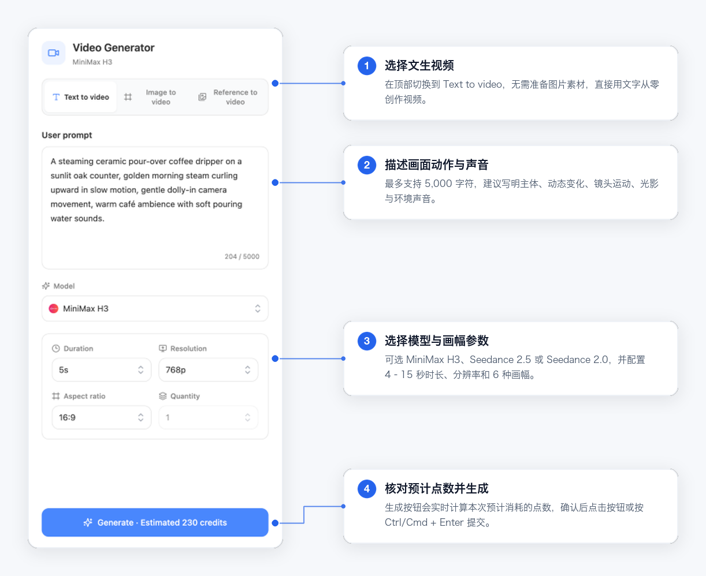

通过 ChatHub 的[视频生成器](https://app.chathub.gg/video-generator)，你可以直接在浏览器中用文字提示词、首尾帧图片或多张参考图创作带有同步音频的 AI 视频。

所有已登录用户（包括免费账号）只要拥有足够点数，均可使用视频生成功能。

## 生成你的第一条视频

<Steps>
  <Step title="打开视频生成器">
    访问 [app.chathub.gg/video-generator](https://app.chathub.gg/video-generator)，或在左侧边栏打开 **工具 → 视频生成器**（英文界面为 `Tools → Video Generator`，也可通过命令菜单进入）。如尚未登录，请先登录账号。
  </Step>
  <Step title="选择模式、模型与参数">
    在左侧面板选择生成模式（**文生视频**、**图生视频**或**参考生视频**），选择模型（**MiniMax H3**、**Seedance 2.5** 或 **Seedance 2.0**），并配置**时长**（4–15 秒）、**分辨率**和**画幅比例**。
  </Step>
  <Step title="输入提示词并核对预计点数">
    在提示词框中描述画面动作、场景和氛围（最多 5,000 字符）。输入就绪后，底部的**生成**按钮会实时计算并显示预计点数（`生成 · 预计 X 点`）。
  </Step>
  <Step title="提交并在后台等待出片">
    点击**生成**（或按快捷键 `Ctrl + Enter` / `Cmd + Enter`），任务会立刻出现在右侧工作区中。**你可以放心切走或关闭网页**，视频会在服务端继续生成，下次回来会自动同步进度。
  </Step>
</Steps>

<Frame caption="视频生成器界面总览：左侧配置模式、提示词与预计点数，右侧查看排队进度与历史记录。">
  
</Frame>

## 后台队列与历史管理

- **多任务并发**：同一时间最多可运行 **3 个**进行中（排队中或生成中）的视频任务。
- **实时进度与完成通知**：进行中的卡片会展示状态（排队中 / 正在生成视频）、已耗时和预计等待区间；允许浏览器通知后，视频出片时会第一时间提醒你。
- **筛选与结果管理**：右侧顶部支持勾选**进行中**或按**任务类型**筛选。每条记录均支持悬浮**查看参数**、点击**展开**并**复制提示词**、**下载** `.mp4` 文件或**删除**已完成/失败的记录。

<Frame caption="右侧历史工作区：支持状态与类型筛选、查看参数提示、展开复制提示词以及下载与删除操作。">
  
</Frame>

## 继续了解

<CardGroup cols={2}>
  <Card title="文生视频" icon="text" href="/cn/video-generation/text-to-video">
    纯文字从零创作视频，自由定制 6 种画幅比例。
  </Card>

  <Card title="图生视频" icon="image" href="/cn/video-generation/image-to-video">
    上传首帧让静图动起来，或搭配可选尾帧控制结局画面。
  </Card>

  <Card title="参考生视频" icon="images" href="/cn/video-generation/reference-to-video">
    上传多张参考图并用交互式图片标签在提示词中精准指代。
  </Card>

  <Card title="模型与提示词技巧" icon="sparkles" href="/cn/video-generation/models-and-prompts">
    对比 MiniMax H3、Seedance 2.5 与 Seedance 2.0，掌握通用提示词公式。
  </Card>
</CardGroup>
