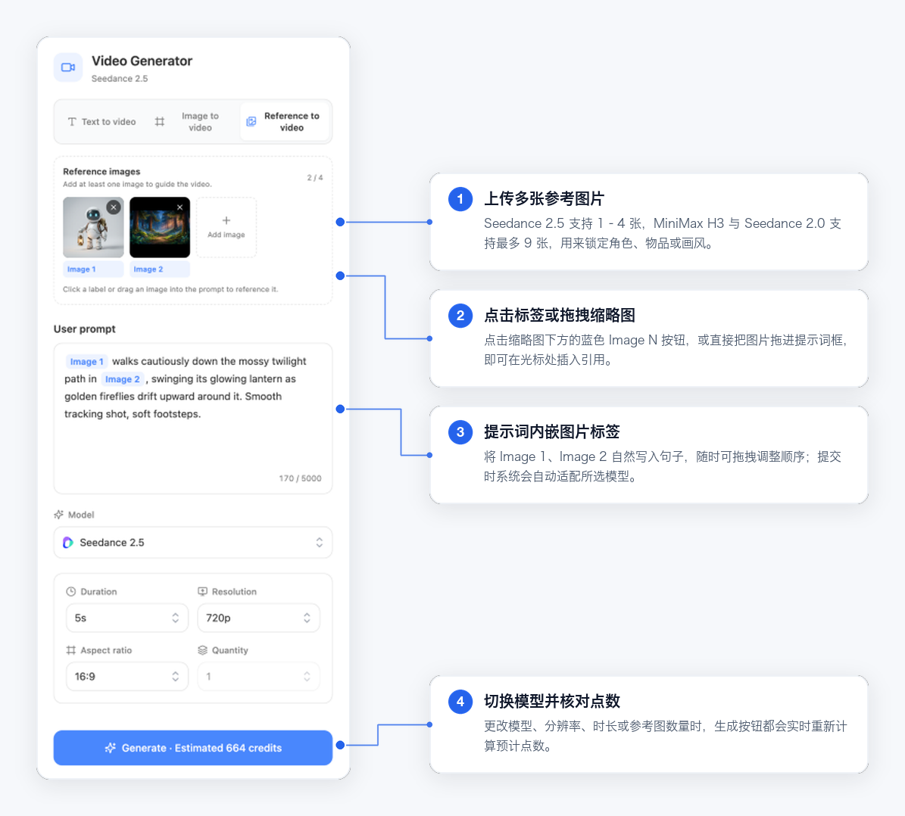

**参考生视频（Reference to video）** 支持上传多张参考图片（例如主角形象、道具物品与目标场景），并在提示词中明确指定每张图在新视频里扮演的角色。

## 各模型参考图数量上限

| 模型 | 参考图数量上限 | 图片要求 |
| --- | --- | --- |
| **MiniMax H3** | 最多 **9** 张 | `JPEG`、`PNG` 或 `WebP`，单张 ≤ **2 MB** |
| **Seedance 2.0** | 最多 **9** 张 | `JPEG`、`PNG` 或 `WebP`，单张 ≤ **2 MB** |
| **Seedance 2.5** | 最多 **4** 张 | `JPEG`、`PNG` 或 `WebP`，单张 ≤ **2 MB** |

## 操作步骤

<Frame caption="参考生视频模式：上传参考图后，通过点击标签或拖拽图片，将蓝色图片标签自然嵌入提示词。">
  
</Frame>

<Steps>
  <Step title="切换模式并选择合适的模型">
    在[视频生成器](https://app.chathub.gg/video-generator)切换到 **参考生视频（Reference to video）**。如果计划上传 5–9 张参考图，请选择 **MiniMax H3** 或 **Seedance 2.0**。
  </Step>
  <Step title="上传参考图片">
    点击 **添加图片（Add image）** 或直接将图片拖入参考图区域，每张图下方都会自动生成按顺序编号的蓝色图片标签（`图片 1`、`图片 2`…）。
  </Step>
  <Step title="在提示词中插入图片标签">
    新上传的图片会自动以蓝色图片标签的形式添加到提示词框中。你也可以随时：

    - **点击缩略图下方的蓝色标签**，在当前光标处插入对应引用；
    - **直接把参考图拖进提示词框**，放置到你想指代的句子位置；
    - **在提示词内拖拽标签**随时调整先后顺序。
  </Step>
  <Step title="设置参数并提交生成">
    选择**时长**（4–15 秒）、**分辨率**与**画幅比例**，核对底部生成按钮的预计点数后提交任务。
  </Step>
</Steps>

<Note>
  无需记忆不同模型的引用格式。提交任务时，ChatHub 会自动将提示词中的蓝色图片标签适配为当前所选模型支持的格式。
</Note>

## 使用建议与示例

- **为每张图明确单一职责**：例如 `图片 1` 放干净背景下的主角，`图片 2` 放目标环境，`图片 3` 放道具或服装，更容易保持元素稳定融合。
- **保持视觉风格协调**：除非明确希望混合不同画风，否则各参考图之间（例如写实摄影与 3D 动画）建议保持风格一致。
- **示例提示词**（`图片 1` = 白色小机器人，`图片 2` = 暮色萤火虫森林小径）：
  > `图片 1` 提着微微发光的提灯，沿着 `图片 2` 中长满青苔的暮色林间小路慢慢前行，金色萤火虫在它周围缓缓飘起。镜头从背后平稳跟拍，伴随轻柔的脚步声和夏夜虫鸣。
