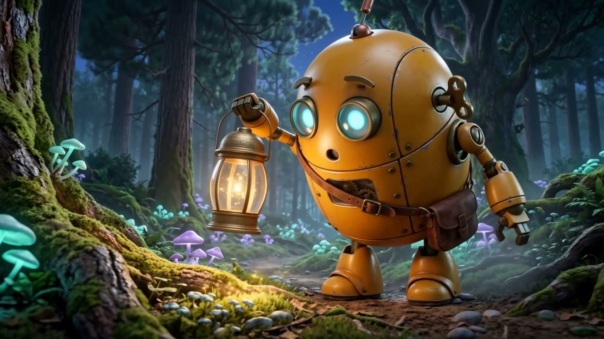
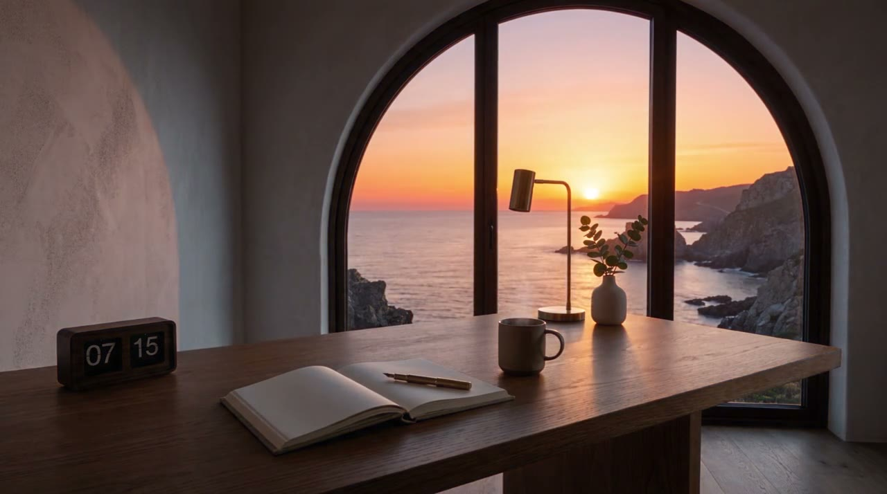
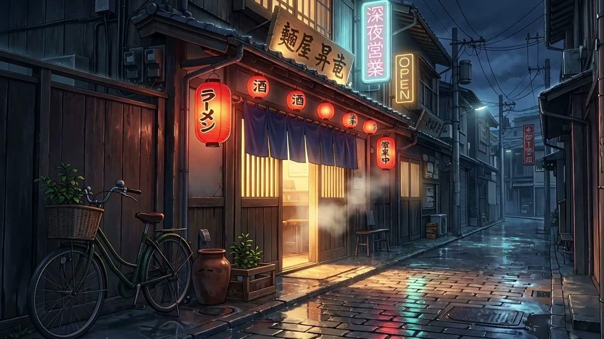
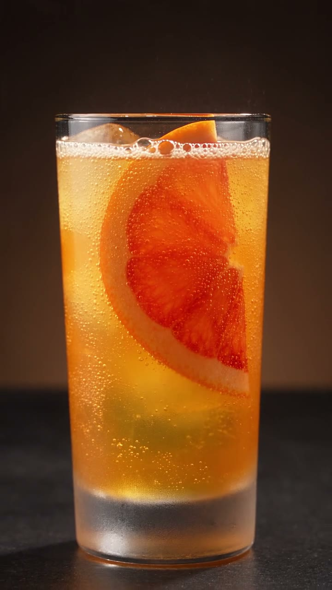
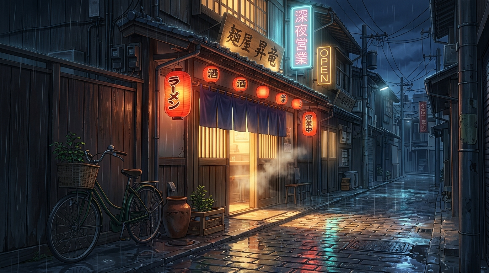
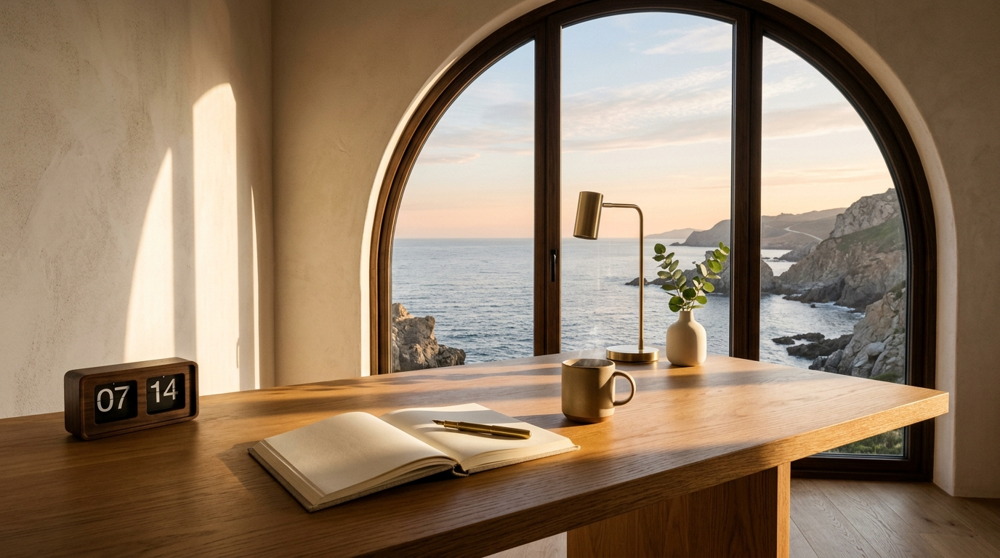
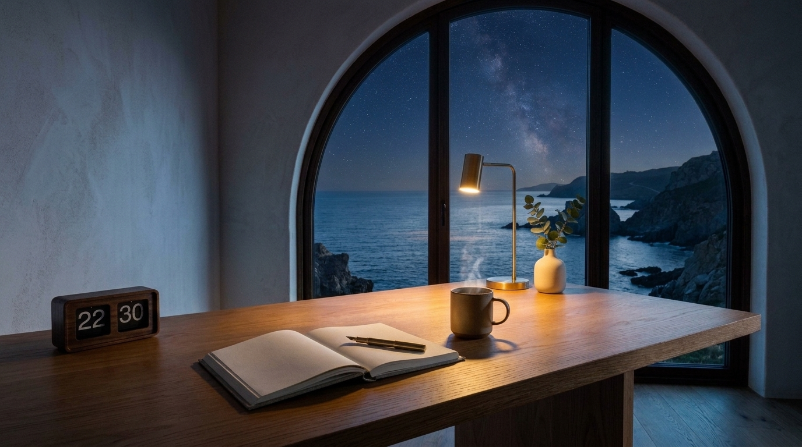
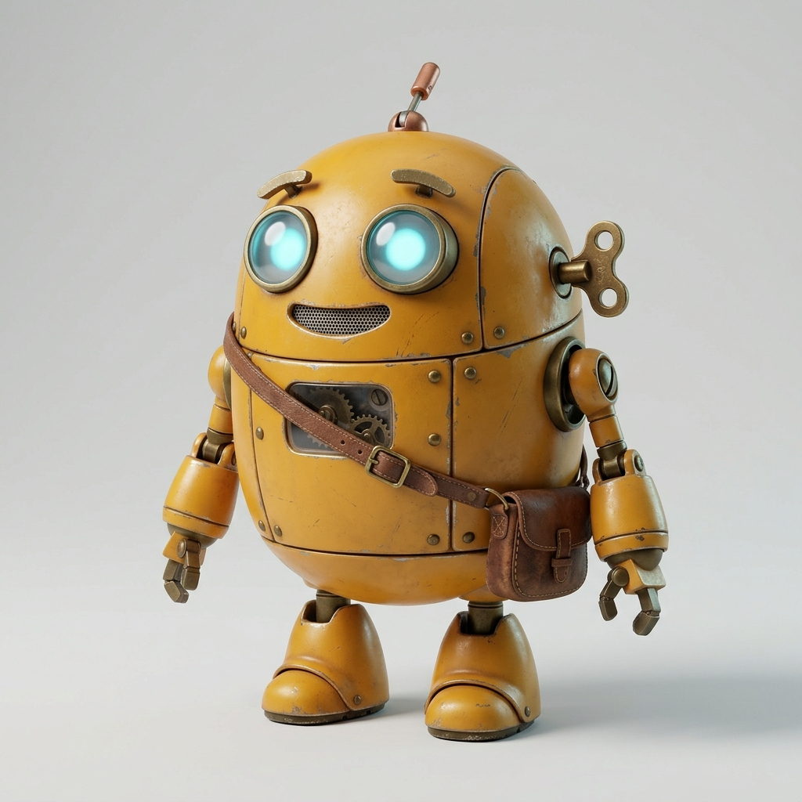
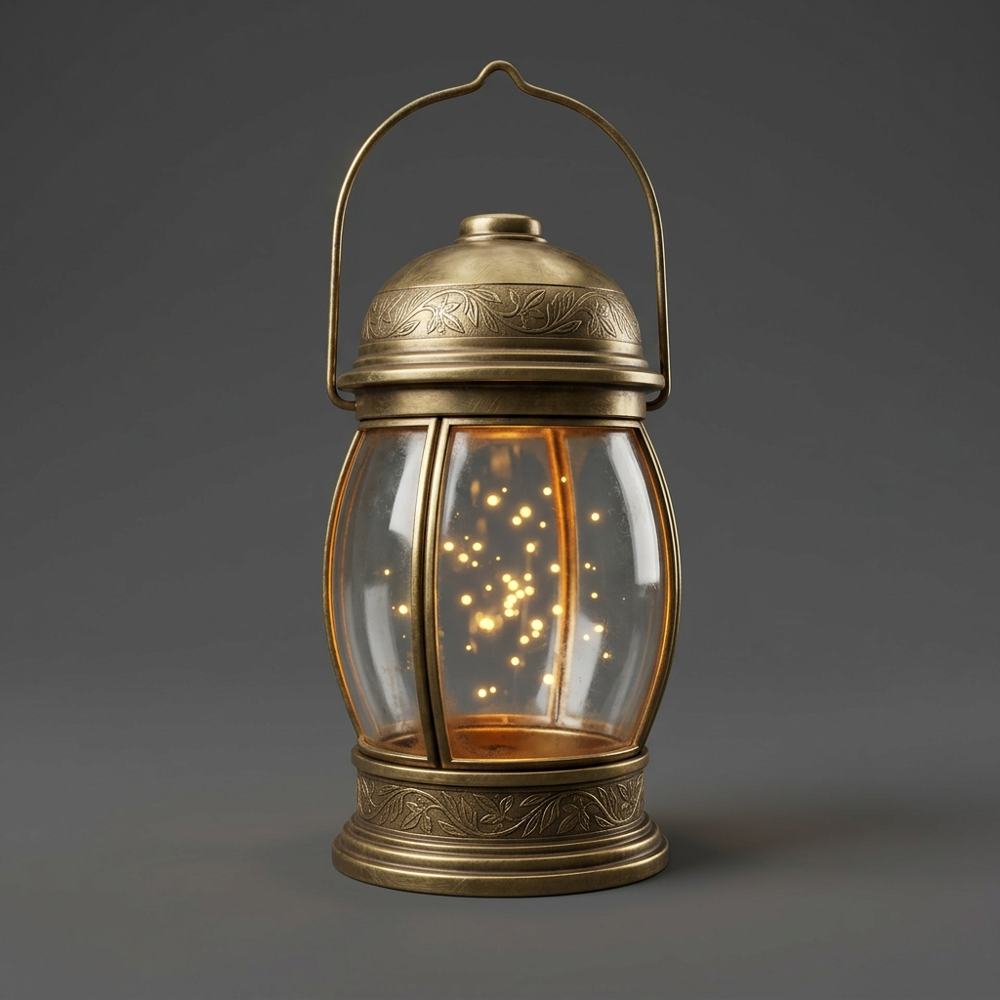
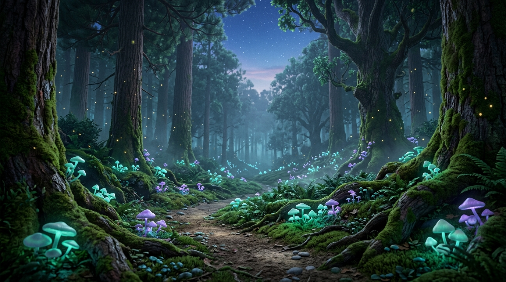

Every video on this page was generated directly inside the [ChatHub Video Generator](https://app.chathub.gg/video-generator) with synchronized audio enabled. Turn your sound on when playing each clip to hear the generated 

<video src="/videos/video-generation/case1-citrus-soda.mp4" controls />

sound effects and ambience.









<video src="/videos/video-generation/case4-robot-forest.mp4" controls />

<video src="/videos/video-generation/case3-desk-timelapse.mp4" controls />

<video src="/videos/video-generation/case2-ramen-alley.mp4" controls />

## Case Overview

| # | Case | Mode | Model | Format | Draft → Final Credits\* |
| :-: | --- | --- | --- | --- | --- |
| **1** | **Sparkling Citrus Soda Commercial** | Text to video | `Seedance 2.5` | `9:16` · `8s` · `1080p` | `296` → `2,729` |
| **2** | **Rainy Neon Ramen Alley** | Image to video _(First frame)_ | `MiniMax H3` | Follows image · `6s` · `2k` | `276` → `449` |
| **3** | **Morning-to-Starry-Night Timelapse** | Image to video _(First + Last)_ | `Seedance 2.5` | Follows image · `10s` · `1080p` | `309` → `3,434` |
| **4** | **Enchanted Forest Robot Mini-Film** | Reference to video _(3 images)_ | `Seedance 2.0` | `16:9` · `8s` · `1080p` | `202` → `1,796` |

<Note>
  \*Estimated credits depend on model pricing, resolution, duration, aspect ratio, and reference image count. Always verify the live quote shown on the **Generate** button before submitting.
</Note>

---

## 1. Sparkling Citrus Soda Commercial (Text to Video)

Create a vertical social-ad macro shot purely from text — no product photography or input assets needed.

<Frame caption="Final output: Seedance 2.5 · Text to video · 9:16 · 8s · 1080p (with synchronized ice, pour, and fizz audio).">
  <div className="mx-auto max-w-[320px]">
  <video controls playsInline preload="metadata" poster="/images/video-generation/examples/case1-poster.jpg" className="w-full rounded-xl">
    <source src="/videos/video-generation/case1-citrus-soda.mp4" type="video/mp4" />
  </video>
</div>
</Frame>

### Prompt

```text
Ultra-crisp commercial studio macro shot on a matte dark slate tabletop. In the first half, crystal-clear ice cubes and a fresh blood-orange slice drop in slow motion into a tall minimalist frosted glass as chilled golden sparkling citrus soda pours from above, sending thousands of lively effervescent bubbles rushing upward with crisp condensation droplets forming on the glass. In the second half, the camera glides smoothly back and slightly orbits to reveal the whole glowing glass backlit by a warm amber rim light against a clean moody backdrop. Synchronized high-definition Foley audio: crisp clinking ice cubes, refreshing liquid pour, and bright fizzy carbonation sizzle.
```

### Settings (Draft vs. Final)

| Stage | Mode | Model | Aspect ratio | Duration | Resolution | Estimated credits |
| --- | --- | --- | --- | --- | --- | --- |
| **Draft** _(test pacing & motion)_ | Text to video | `Seedance 2.5` | `9:16` | `5s` | `480p` | `296` |
| **Final** _(export quality)_ | Text to video | `Seedance 2.5` | `9:16` | `8s` | `1080p` | `2,729` |

### Why This Works

- **Two-beat timing:** Splitting the action into _"In the first half…"_ (macro pour and rising bubbles) and _"In the second half…"_ (smooth pull-back hero reveal) gives the clip a clear commercial rhythm instead of a single repetitive motion.
- **Explicit Foley sound cues:** Naming the exact sounds (`clinking ice cubes`, `liquid pour`, `fizzy carbonation sizzle`) dramatically improves the generated audio track.
- **Draft at `480p` first:** Testing at `5s` + `480p` costs roughly **1/9th** of the final `8s` + `1080p` render — iterate on framing and pacing before paying for full HD.

---

## 2. Rainy Neon Ramen Alley (Image to Video · First Frame)

Bring a static illustration or concept art piece to life in crisp `2k` resolution while keeping signs, architecture, and line work rock-solid.

### Input Asset (First Frame)

<Frame caption="Uploaded First frame (16:9 anime-style rainy ramen alley illustration). Right-click to save and try it yourself.">
  
</Frame>

### Output Video

<Frame caption="Final output: MiniMax H3 · Image to video · Follows input image · 6s · 2k (with steady rain and alley ambience).">
  <video controls playsInline preload="metadata" poster="/images/video-generation/examples/case2-poster.jpg" className="w-full rounded-xl">
    <source src="/videos/video-generation/case2-ramen-alley.mp4" type="video/mp4" />
  </video>
</Frame>

### Prompt

```text
Gentle atmospheric animation of the rainy night alley. Fine raindrops fall steadily across the glowing neon signs and red paper lanterns, creating subtle expanding ripples across the wet cobblestone puddles while colorful reflections shimmer. Warm white steam drifts softly upward and curls outward beneath the indigo doorway curtain as the hanging lanterns sway slightly in a cool night breeze. Very slow, steady cinematic camera push-in along the alley toward the warm glowing shopfront. Synchronized ambient audio: soothing steady rainfall on pavement and eaves, soft distant breeze, and faint cozy kitchen murmur from inside the shop.
```

### Settings (Draft vs. Final)

| Stage | Mode | Model | Aspect ratio | Duration | Resolution | Estimated credits |
| --- | --- | --- | --- | --- | --- | --- |
| **Draft** | Image to video _(First frame)_ | `MiniMax H3` | Follows input image | `6s` | `768p` | `276` |
| **Final** | Image to video _(First frame)_ | `MiniMax H3` | Follows input image | `6s` | `2k` | `449` |

### Why This Works

- **Animate only what should move:** Because the model already sees the illustration, the prompt skips re-describing static objects (bicycle, wooden wall, sign text) and focuses strictly on moving layers — rain, puddle ripples, curling steam, gentle lantern sway, and a restrained push-in.
- **Preserves text & line work:** Restrained camera movement paired with `MiniMax H3` at `2k` keeps Japanese signage sharp instead of melting or hallucinating characters.
- **High quality-to-credit ratio:** `MiniMax H3` renders crisp `2k` animation for only `449` credits at `6s`, making it ideal for animated posters, YouTube intros, and looping backdrops.

---

## 3. Morning-to-Starry-Night Timelapse (Image to Video · First + Last Frame)

Lock the camera position and supply both a **First frame** and a **Last frame** to direct a seamless full-day lighting transition.

### Input Assets (First Frame → Last Frame)

<div className="grid grid-cols-1 gap-4 sm:grid-cols-2">
  <Frame caption="First frame: Morning sunlight (07:14, desk lamp off).">
    
  </Frame>

  <Frame caption="Last frame: Starry night (22:30, brass desk lamp on).">
    
  </Frame>
</div>

### Output Video

<Frame caption="Final output: Seedance 2.5 · Image to video (First + Last frame) · Follows input image · 10s · 1080p.">
  <video controls playsInline preload="metadata" poster="/images/video-generation/examples/case3-poster.jpg" className="w-full rounded-xl">
    <source src="/videos/video-generation/case3-desk-timelapse.mp4" type="video/mp4" />
  </video>
</Frame>

### Prompt

```text
Completely locked static tripod camera capturing a smooth, continuous day-to-night time-lapse from morning to late night. Outside the arched window, soft morning clouds drift swiftly across the sky as golden sunlight arcs across the plaster wall and oak desk, warming into a brief amber sunset glow over the ocean cliffs before fading into deep twilight and revealing a sparkling starry night sky with moonlight over the sea. As dusk settles indoors, the flip clock clicks forward across the hours and the brushed-brass desk lamp gently switches on, bathing the open sketchbook, pen, and steaming mug in a warm golden glow. Synchronized ambient soundscape: distant ocean waves gently swelling and fading, subtle soft breeze, crisp mechanical clock flip ticks, and a quiet click as the desk lamp turns on.
```

### Settings (Draft vs. Final)

| Stage | Mode | Model | Aspect ratio | Duration | Resolution | Estimated credits |
| --- | --- | --- | --- | --- | --- | --- |
| **Draft** | Image to video _(First + Last)_ | `Seedance 2.5` | Follows input image | `5s` | `480p` | `309` |
| **Final** | Image to video _(First + Last)_ | `Seedance 2.5` | Follows input image | `10s` | `1080p` | `3,434` |

### Why This Works

- **Pixel-locked framing across both frames:** Keeping every object (window mullions, desk, sketchbook, mug, lamp, vase, flip clock) in the exact same position prevents awkward morphing and lets the model devote all its motion to lighting, sky, and time.
- **Describe the middle stages:** Neither input image shows sunset — explicitly mentioning _"warming into a brief amber sunset glow… before fading into deep twilight"_ guides the model to generate a believable intermediate sunset arc.
- **Give big transitions enough time:** Spanning 15 hours of daylight change works best at **`8–10s`**; trying to squeeze it into `4–5s` often feels rushed or abrupt.

---

## 4. Enchanted Forest Robot Mini-Film (Reference to Video · 3 Images)

Separate your **character**, **prop**, and **environment** into distinct reference images and bind each one with inline blue reference tags so design details stay consistent across shots.

### Input Assets (3 Reference Images)

Upload these three images in exact order (`Image 1`, `Image 2`, `Image 3`) in **Reference to video** mode:

<div className="grid grid-cols-1 gap-4 sm:grid-cols-3">
  <Frame caption="Image 1 — Character (yellow clockwork robot)">
    
  </Frame>

  <Frame caption="Image 2 — Prop (antique firefly lantern)">
    
  </Frame>

  <Frame caption="Image 3 — Environment (twilight mushroom forest)">
    
  </Frame>
</div>

### Output Video

<Frame caption="Final output: Seedance 2.0 · Reference to video (3 images) · 16:9 · 8s · 1080p.">
  <video controls playsInline preload="metadata" poster="/images/video-generation/examples/case4-poster.jpg" className="w-full rounded-xl">
    <source src="/videos/video-generation/case4-robot-forest.mp4" type="video/mp4" />
  </video>
</Frame>

### Prompt

When entering the prompt in ChatHub, replace each `[Image N]` placeholder below by **clicking the blue `Image N` label** below the matching thumbnail (or dragging the thumbnail into the prompt box):

```text
Cinematic 3D animated film shot. [Image 1] carefully holds [Image 2] by its wire handle in one hand and walks with cute, lively mechanical steps along the mossy dirt path deep inside [Image 3]. Warm golden light from [Image 2] illuminates the robot's yellow metal shell and casts soft shadows across the glowing teal mushrooms as gentle mist curls around its feet. Midway through, [Image 1] pauses to look up in wonder as a swirl of golden fireflies rises from the moss around it, its cyan eyes glowing brightly. Smooth low-angle tracking camera gliding steadily alongside and slightly ahead of the robot. Synchronized cinematic audio: tiny rhythmic clockwork footsteps on soft forest earth, gentle mechanical whirring, subtle lantern chime, and magical twilight forest crickets and breeze.
```

### Settings (Draft vs. Final)

| Stage | Mode | Model | Aspect ratio | Duration | Resolution | Estimated credits |
| --- | --- | --- | --- | --- | --- | --- |
| **Draft** | Reference to video _(3 images)_ | `Seedance 2.0` | `16:9` | `5s` | `480p` | `202` |
| **Final** | Reference to video _(3 images)_ | `Seedance 2.0` | `16:9` | `8s` | `1080p` | `1,796` |

### Why This Works

- **One image, one clear role:** Isolating the character (`Image 1`) and prop (`Image 2`) on clean studio backgrounds while keeping the scene (`Image 3`) completely empty of characters lets the model combine all three cleanly without visual clutter.
- **Consistent 3D art direction:** All three reference images share the same stylized 3D PBR film look, so the robot and lantern naturally pick up the forest's lighting and reflections.
- **Match output aspect ratio to your background:** Choosing `16:9` matches the framing of `Image 3` and gives the tracking shot plenty of horizontal breathing room.

<Tip>
  Want to create a multi-shot story with the exact same character and lantern? Reuse `Image 1` and `Image 2` across multiple generations while swapping only `Image 3` (new location) and the action prompt.
</Tip>

---

## Ready to Try It Yourself?

<CardGroup cols={2}>
  <Card title="Open Video Generator" icon="video" href="https://app.chathub.gg/video-generator">
    Copy any prompt above and try a low-cost 5s draft directly in ChatHub.
  </Card>

  <Card title={"Models & Prompting Tips"} icon="sparkles" href="/video-generation/models-and-prompts">
    Compare model capabilities and review the universal five-part prompt formula.
  </Card>
</CardGroup>
