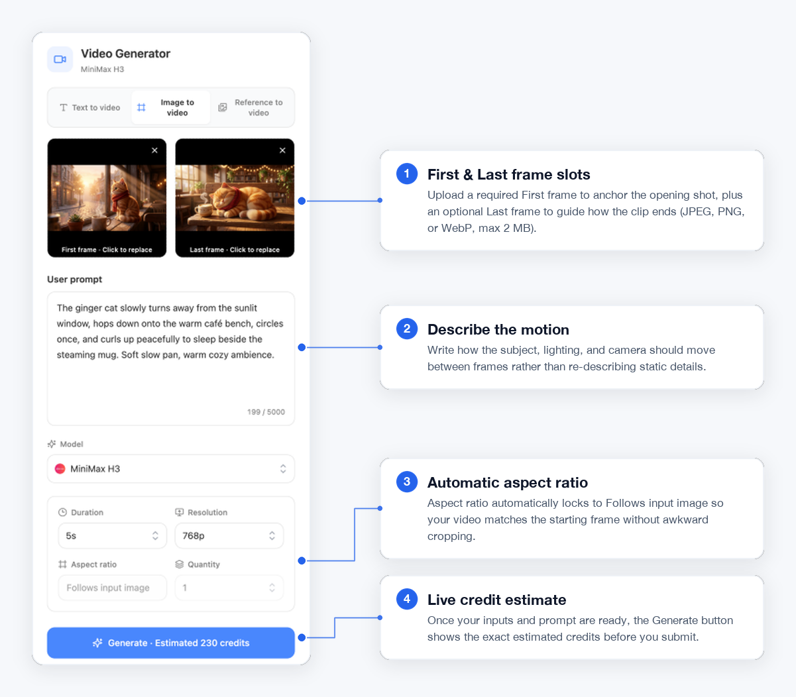

**Image to video** brings a static image to life. Upload a **First frame** to animate from a starting scene, or add an optional **Last frame** to define how the clip concludes.

## How to Use Image to Video

<Frame caption="Image to video mode with First frame and optional Last frame. Aspect ratio locks to Follows input image.">
  
</Frame>

<Steps>
  <Step title="Select Image to video">
    In the [Video Generator](https://app.chathub.gg/video-generator), switch to **Image to video** in the top mode bar.
  </Step>
  <Step title="Upload First frame (and optional Last frame)">
    Click or drag an image into the **First frame** (**Required**) slot. To guide the ending composition, upload a second image into **Last frame** (**Optional**).
  </Step>
  <Step title="Describe the motion and transition">
    In **User prompt**, focus on how the subject and camera move from the first frame onward — and how the scene transitions into the last frame, if provided.
  </Step>
  <Step title="Review credits and generate">
    Choose your **Model**, **Duration** (4–15s), and **Resolution**, verify the estimate on the **Generate** button, and submit.
  </Step>
</Steps>

<Note>
  In **Image to video** mode, **Aspect ratio** automatically switches to **Follows input image**. The generated video matches your starting frame's proportions to prevent unintended cropping.
</Note>

## Image Requirements

- **Supported formats:** `JPEG`, `PNG`, and `WebP` (must be genuine image files, not renamed from other formats)
- **Maximum file size:** **2 MB** per image
- **Privacy policy:** Certain video models (including Seedance) restrict uploading photos that appear to contain real people. If you encounter a privacy restriction, try illustrated, stylized, or non-human imagery instead.

## Prompting Tip & Example

Because the model already sees your uploaded image(s), avoid repeating static background details and focus your prompt on **movement, pacing, camera motion, and sound**.

- **First + Last frame example** _(ginger cat on a sunlit windowsill → curled up asleep on a café bench)_:
  > _The ginger cat slowly turns away from the sunlit window, hops down onto the warm café bench, circles once, and curls up peacefully to sleep beside the steaming mug. Soft slow pan, warm cozy ambience._

<Tip>
  Using both **First frame** and **Last frame** works best when both images share consistent lighting, character design, and framing — with enough duration (such as 5–8s) for a smooth transition.
</Tip>
