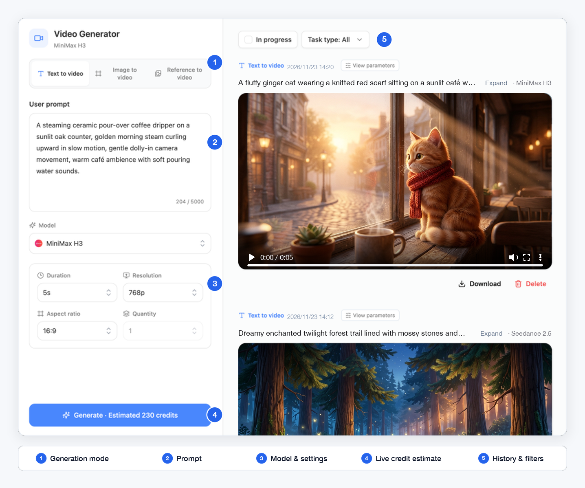
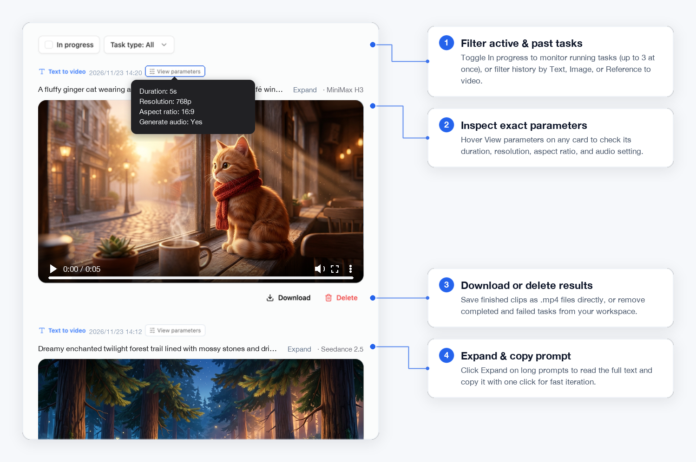

ChatHub's [Video Generator](https://app.chathub.gg/video-generator) lets you create short AI videos with synchronized audio from text prompts, starting/ending frames, or reference images directly in your browser.

All signed-in users (including Free accounts with sufficient credits) can use the Video Generator.

## Create Your First Video

<Frame caption="Video Generator overview: creation controls and live credit estimate on the left, generation queue and history on the right.">
  
</Frame>

<Steps>
  <Step title="Open Video Generator">
    Go to [app.chathub.gg/video-generator](https://app.chathub.gg/video-generator), or open **Tools → Video Generator** from the left sidebar. Sign in if prompted.
  </Step>
  <Step title="Choose a mode, model, and format">
    Select one of the three generation modes (**Text to video**, **Image to video**, or **Reference to video**), choose a model (**MiniMax H3**, **Seedance 2.5**, or **Seedance 2.0**), and configure **Duration** (4–15s), **Resolution**, and **Aspect ratio**.
  </Step>
  <Step title="Write your prompt and review estimated credits">
    Describe the scene, motion, and atmosphere in **User prompt** (up to 5,000 characters). Once your settings and inputs are complete, the **Generate** button calculates and displays the estimated cost (`Generate · Estimated X credits`).
  </Step>
  <Step title="Submit and let it run in the background">
    Click **Generate** (or press `Ctrl + Enter` / `Cmd + Enter`). Your task appears immediately in the right workspace. You can safely switch tabs or close the page — generation continues in the cloud, and your progress restores automatically when you return.
  </Step>
</Steps>

## Queue & History Workspace

<Frame caption="History workspace filters, parameter tooltip, prompt expansion, and download/delete actions.">
  
</Frame>

- **Run multiple tasks at once:** You can have up to **3 active tasks** (in queue or generating) running at the same time.
- **Live progress & notifications:** Active cards display the current status (**In queue** or **Generating video**), elapsed time, and an estimated wait range. Enable browser notifications when prompted to receive an alert as soon as your video is ready.
- **Filter & manage results:** Use the top bar to view **In progress** tasks or filter by **Task type**. On any card, hover over **View parameters** to inspect the exact settings, click **Expand** to read and **Copy prompt**, **Download** the `.mp4` file, or **Delete** completed and failed items.

## Explore Next

<CardGroup cols={2}>
  <Card title={"Examples & Showcase"} icon="clapperboard" href="/video-generation/examples">
    Watch 4 real ChatHub outputs with audio, downloadable input assets, and prompts.
  </Card>

  <Card title="Text to Video" icon="text" href="/video-generation/text-to-video">
    Create original clips purely from text with full aspect ratio control.
  </Card>

  <Card title="Image to Video" icon="image" href="/video-generation/image-to-video">
    Animate a starting frame or smoothly transition to an optional ending frame.
  </Card>

  <Card title="Reference to Video" icon="images" href="/video-generation/reference-to-video">
    Combine multiple reference images using clickable prompt tags.
  </Card>

  <Card title={"Models & Prompting"} icon="sparkles" href="/video-generation/models-and-prompts">
    Compare MiniMax H3, Seedance 2.5, and Seedance 2.0, plus prompting formulas.
  </Card>
</CardGroup>
