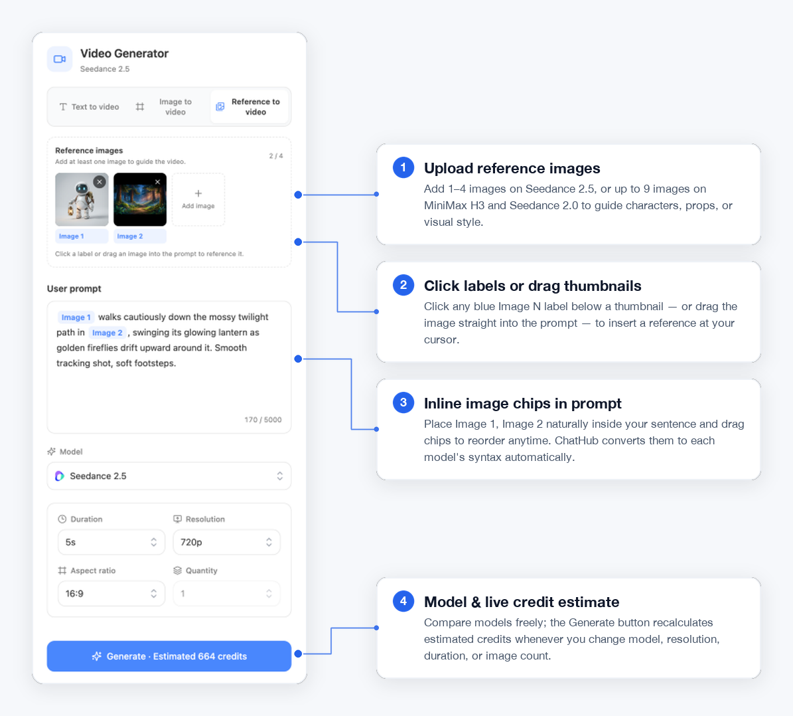

**Reference to video** lets you upload one or more reference images — such as a character, a prop, and a background — and direct how each element appears in a new video scene.

## Reference Limits by Model

| Model | Maximum reference images | Image requirements |
| --- | --- | --- |
| **MiniMax H3** | Up to **9** images | `JPEG`, `PNG`, or `WebP`, max **2 MB** each |
| **Seedance 2.0** | Up to **9** images | `JPEG`, `PNG`, or `WebP`, max **2 MB** each |
| **Seedance 2.5** | Up to **4** images | `JPEG`, `PNG`, or `WebP`, max **2 MB** each |

## How to Use Reference to Video

<Frame caption="Reference to video mode: upload images and insert clickable Image 1 / Image 2 tags directly into your prompt.">
  
</Frame>

<Steps>
  <Step title="Select Reference to video and choose a model">
    Switch to **Reference to video** in the [Video Generator](https://app.chathub.gg/video-generator). If you plan to upload 5–9 images, select **MiniMax H3** or **Seedance 2.0**.
  </Step>
  <Step title="Upload your reference images">
    Click **Add image** or drag and drop image files into the **Reference images** area. Each uploaded image receives an ordered blue label (`Image 1`, `Image 2`, …).
  </Step>
  <Step title="Reference images directly inside your prompt">
    Newly uploaded images are automatically added to **User prompt** as clickable blue tags (`Image 1`, `Image 2`). You can also:

    - **Click any blue `Image N` label** below a thumbnail to insert a tag at your cursor.
    - **Drag a thumbnail directly into the prompt box** to drop a tag at the exact position you want.
    - **Drag tags inside the prompt** to reorder them at any time.
  </Step>
  <Step title="Set format, check credits, and generate">
    Choose **Duration** (4–15s), **Resolution**, and **Aspect ratio**, review the live credit estimate on the **Generate** button, and submit.
  </Step>
</Steps>

<Note>
  There is no need to memorize model-specific formatting rules. ChatHub automatically formats each `Image N` tag for the selected model when you submit your task.
</Note>

## Tips & Example

- **Assign each image one clear role** (for example, `Image 1` for the main character on a clean background, `Image 2` for the setting, and `Image 3` for a prop or outfit).
- **Keep visual styles compatible** across references unless you intentionally describe how different styles should blend.
- **Example prompt** _(`Image 1` = miniature white explorer robot, `Image 2` = glowing twilight forest trail)_:
  > _`Image 1` walks cautiously down the mossy twilight path in `Image 2`, swinging its glowing lantern as golden fireflies drift upward around it. Smooth tracking shot, soft footsteps and gentle evening crickets._

<Tip>
  See a complete 3-reference-image walkthrough with downloadable assets and playable output in [Examples & Showcase](/video-generation/examples).
</Tip>
